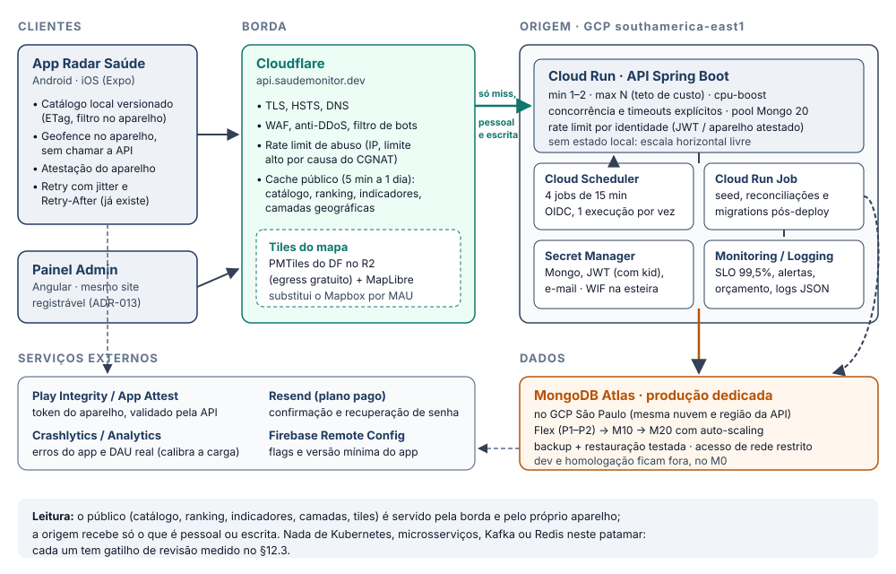

<section class="capa" markdown="1">

Radar Saúde · saude-monitor

# Análise de Escalabilidade, Segurança e Custo para o Distrito Federal

Engenharia de Software · Arquitetura de Software · Arquitetura de Soluções

| Campo | Valor |
|---|---|
| **Versão** | 1.0 |
| **Data** | 17/10/2026 |
| **Atualização** | 18/10/2026: Quarkus na §12.3 e §12.4, cache AOT do Java 25 no SOL-04 e novo gap SOL-09 (e-mail em `@Async`) |
| **Status** | 🟡 Proposta — aguarda as respostas do §17 |
| **Commit-base** | `develop@1d2e431` (homologação `v1.0.0-rc.5`) |
| **Pedido do PO** | Sistema escalável e seguro, com o menor custo que entregue valor, para uso por 60–70% da população do DF |
| **Autoria** | Análise assistida (Claude Code), a pedido do Product Owner (Gabriel Vogado) |
| **Documentos-base** | `Plano-Escala-Infraestrutura-DF-v1.0` · `Plano-Implantacao-Cache-Fila-Resiliencia-v1.0` · `Relatorio-Desempenho-HML-2026-09-23` · `Pentest-HML-2026-09-23` · ADR-011 a ADR-015 · `Documento-Negocial-v2.1` |

Nenhuma linha de código foi alterada e nenhum teste de carga foi executado para produzir este relatório. Cada achado foi verificado no código do commit-base (arquivo:linha) ou nos documentos citados. Valores de custo são estimativas a partir de preços de lista de outubro/2026 e precisam ser conferidos nas calculadoras dos provedores antes de contratar.

</section>

## Sumário

1. Sumário executivo
2. Contexto, meta e método
3. Modelo de carga revisado
4. Setor 1 — Arquitetura de Soluções (infraestrutura e nuvem)
5. Setor 2 — Arquitetura de Software (backend)
6. Setor 3 — Aplicativo móvel
7. Setor 4 — Segurança da Informação
8. Setor 5 — Privacidade e Dados (LGPD)
9. Setor 6 — Desempenho e Capacidade
10. Setor 7 — Operação e Observabilidade
11. Setor 8 — Engenharia de Software (processo e governança)
12. Arquitetura-alvo
13. Custos estimados por patamar
14. Roteiro de implantação e critérios para o lançamento público
15. Plano da prova de carga
16. Decisão proposta — ADR-016
17. Perguntas para alinhamento, com sugestões recomendadas

<!-- -->

- Anexo A — Matriz de priorização completa
- Anexo B — Fórmulas e premissas
- Anexo C — Fontes, método e skills aplicadas

---

## 1. Sumário executivo

### 1.1 Resposta curta

**A desconfiança procede: o sistema nunca foi medido sob carga.** O teste de 23/09/2026 mandou 1.200 requisições em 162 segundos, ou **~7,4 req/s**. Ele mostra que o sistema funciona, não quanto aguenta. Hoje há quatro tetos rígidos que nenhuma máquina maior resolve:

- **uma instância só** (trava do seed);
- **banco gratuito** compartilhado com dev e homologação, que estrangula com cerca de **250 pessoas usando ao mesmo tempo**;
- **rate limit por IP**, que vai bloquear gente real atrás do CGNAT das operadoras;
- **leitura pública sem cache**.

**A meta é alcançável, com pouco dinheiro e sem Kubernetes nem microsserviços.** Com 60–70% do DF instalado (~1,8 a 2,1 milhões de pessoas), a infraestrutura fica na ordem de **US$ 275–710/mês** (§13). Para isso, cinco frentes precisam acontecer, nesta ordem de importância:

1. **Tirar do servidor o que é público.** O aplicativo baixa o catálogo inteiro (~341 estabelecimentos, dezenas de KB) e filtra no aparelho; ranking, indicadores e camadas saem da borda (CDN). Isso também elimina uma fonte de carga que o plano de escala não previu: o recálculo de geofence em segundo plano, que sozinho dobra o tráfego na meta (§3).
2. **Destravar a escala horizontal:** seed e jobs fora da instância, rate limit por identidade, timeouts e limite de concorrência.
3. **Separar a produção:** banco dedicado na mesma nuvem e região da API, com backup testado.
4. **Proteger a integridade do ranking.** Hoje uma avaliação válida custa três chamadas HTTP, sem prova de presença (SEG-01). Em um produto de transparência pública, esse é o ataque mais provável.
5. **Medir antes de lançar:** alertas, SLO e uma prova de carga distribuída que substitua as hipóteses por números.

### 1.2 Placar dos gaps

| Setor | Crítico | Alto | Médio | Baixo | Total |
|---|:-:|:-:|:-:|:-:|:-:|
| 1. Arquitetura de Soluções | 3 | 4 | 2 | – | 9 |
| 2. Arquitetura de Software | 2 | 1 | 3 | 3 | 9 |
| 3. Aplicativo móvel | 1 | 1 | 2 | – | 4 |
| 4. Segurança da Informação | 1 | 1 | 5 | 1 | 8 |
| 5. Privacidade e Dados | – | 2 | 1 | – | 3 |
| 6. Desempenho e Capacidade | 1 | 1 | 1 | 1 | 4 |
| 7. Operação e Observabilidade | – | 2 | 3 | – | 5 |
| 8. Engenharia de Software | – | 2 | 2 | – | 4 |
| **Total** | **8** | **14** | **19** | **5** | **46** |

### 1.3 Os dez gaps prioritários

Prioridade = (Impacto + Risco) × (6 − Esforço), de 2 a 50; quanto maior, mais cedo (método no §2.3, matriz completa no Anexo A).

| # | Gap | Severidade | Prioridade | Fase |
|---|---|---|:-:|:-:|
| DAD-02 | Banco sem backup gerenciado nem teste de restauração | Alto | 45 | 3 |
| SOL-01 | Banco gratuito compartilhado com dev e homologação | Crítico | 40 | 3 |
| SOL-03 | API sem borda (CDN, WAF, anti-DDoS) e sem domínio próprio | Crítico | 40 | 2 |
| ARQ-02 | Rate limit em memória, por IP, que pega usuários legítimos | Crítico | 40 | 1 |
| PERF-01 | Capacidade nunca medida (teste a ~7,4 req/s) | Crítico | 40 | 4 |
| SOL-08 | E-mail transacional limitado a 100/dia | Alto | 40 | 3 |
| PERF-02 | Modelo de carga sem o tráfego de fundo, de token e de mapa | Alto | 40 | 0 |
| OPS-01 | Sem alertas, SLO e orçamento de erro | Alto | 40 | 0 |
| ENG-01 | RNFs de escala, abuso, RPO/RTO e custo não especificados | Alto | 40 | 0 |
| SOL-04 | Cold start devolvendo HTTP 503 | Alto | 35 | 3 |

O SEG-01 (ranking manipulável) e o APP-01 (tráfego de fundo do geofence) são **críticos** e têm prioridade numérica menor só porque o esforço é maior. Não podem esperar: começam na Fase 1 e precisam estar resolvidos antes do lançamento público (§14).

### 1.4 O que está bom e deve ser mantido

- **Esteira de qualidade acima da média:** cobertura mínima de 90% no código novo, trava de contagem de testes, SonarQube Cloud e Testcontainers para MongoDB no backend.
- **Implantação sem credencial de longa duração:** Workload Identity Federation e Secret Manager; o deploy falha de propósito quando falta o segredo do ambiente.
- **Autenticação e autorização sólidas para usuário logado:** BCrypt, access de 15 min, refresh de 30 dias com rotação e blacklist com TTL. O pentest não encontrou BOLA, BFLA nem injeção nesse fluxo.
- **Cliente HTTP resiliente:** backoff exponencial com *jitter*, respeito ao `Retry-After`, sem repetir 429, e fila offline (`frontend/src/config/http.js:193-261`).
- **Geofencing nativo** que respeita o limite de 20 regiões do iOS: 19 hospitais mais 1 região de recálculo (`GeofencingTaskService.js:129`).
- **Otimizações já feitas no banco:** job de indicadores incremental, N+1 do feedback sem resposta resolvido e índices compostos de visita.
- **Disciplina documental:** histórico de melhorias, De-Para, commit-base declarado e ADRs.

---

## 2. Contexto, meta e método

### 2.1 A meta em números

| Referência | Valor |
|---|---|
| População do DF | 2,82 mi (Censo 2022); o plano de escala usa **3,0 mi**, arredondando para cima |
| 60–70% da população | **~1,8 a 2,1 milhões de pessoas** |
| Patamar equivalente no plano de escala | entre **P3** (900 mil instalados) e **P4** (2,4 mi instalados) |
| Usuários ativos por dia (10% dos instalados, premissa D1) | ~180 a 210 mil |
| Usuários simultâneos no pico (premissas do plano) | ~2.250 a 2.600 |

> Parte da população (crianças, pessoas sem smartphone) não instala aplicativo nenhum. Por isso, 60–70% da população total é uma fatia muito maior dos adultos com smartphone, uma meta de alcance ambiciosa. A pergunta 1 (§17) confirma como a meta deve ser medida.

### 2.2 "100 mil requisições": o que significa em cada leitura

A unidade muda a resposta por ordens de grandeza. Pela jornada medida, cada requisição gera em média ~3,4 operações no MongoDB (41 operações ÷ 12 requisições).

| Leitura | Taxa | Equivale a | O sistema de hoje aguenta? |
|---|---|---|---|
| 100 mil por **dia** | ~1,2 req/s | Lançamento (P1) | Sim, abaixo do que já foi medido |
| 100 mil por **hora** | ~28 req/s | Entre P1 e P2 | A API provavelmente sim (falta medir); o banco M0 fica no limite: ~95 op/s contra teto de 100 |
| 100 mil por **minuto** | ~1.670 req/s | Entre P4 e P5 (evento) | Não. Exige borda, dezenas de instâncias e banco M20/M30 |
| 100 mil por **segundo** | 100.000 req/s | Acima do cenário P6 | Só a borda absorve, e só para leitura pública |
| 100 mil **usuários simultâneos** | ~12 mil req/s no pico | 2× o cenário de evento P5 | Não. Exige "modo evento": leitura pela borda e escrita só de quem está numa unidade |

### 2.3 Método e escala de severidade

**Método.** (1) Leitura dos documentos ativos de `Documentos/`, em especial planos, relatórios e ADRs. (2) Verificação de cada afirmação no código do commit-base, por arquivo e linha. (3) Remodelagem da carga com as premissas do plano de escala, acrescida das fontes de tráfego que ele não cobria. (4) Classificação de cada gap por severidade e prioridade.

| Severidade | Critério |
|---|---|
| Crítico | Impede atingir a meta ou compromete a segurança ou a integridade dos dados em escala. Precisa estar resolvido antes do lançamento público. |
| Alto | Quebra num patamar previsível (P1–P3) ou expõe risco relevante de segurança, privacidade ou operação. |
| Médio | Degrada custo, qualidade ou resiliência. Resolver antes de P3–P4. |
| Baixo | Higiene e endurecimento. Pode entrar junto de outro trabalho. |

**Prioridade** (skill `engineering:tech-debt`): `(Impacto + Risco) × (6 − Esforço)`, cada nota de 1 a 5. Esforço 1 = horas; 5 = semanas.

### 2.4 Limitações

- Nada foi executado contra os ambientes. Capacidade por instância, fração de cache e premissas de uso **são hipóteses** até a prova de carga (§15) e até existir telemetria de uso real (OPS-03).
- Dois achados de segurança (SEG-01 e SEG-02) foram identificados **por leitura de código e não foram explorados**. A confirmação exige teste autorizado.
- A configuração de rede do Atlas e as contas dos provedores não foram inspecionadas (SEG-08 fica "a confirmar").

---

## 3. Modelo de carga revisado

### 3.1 O que o plano de escala não modelou

O plano de 08/10/2026 dimensiona pela **sessão de uso** (12 requisições por jornada). Faltou uma fonte de tráfego que cresce com **o deslocamento das pessoas pela cidade**, não com o uso do app:

> Com a localização "o tempo todo" concedida, o app monitora os 19 estabelecimentos mais próximos e uma **região de recálculo** de até 2,5 km (`GeofencingTaskService.js:129-133`). Cada vez que a pessoa sai dessa região, o app chama `GET /api/v1/hospitais?latitude=…&longitude=…&raioKm=5&size=50` (`:731-737`). A latitude e a longitude são exatas, então nenhuma chamada é cacheável, e cada uma custa ~2 operações no Mongo (`$nearSphere` + indicadores).

**Premissas desta estimativa (ajustáveis):**

- 40% dos instalados concedem localização em segundo plano;
- 10 recálculos por dia por pessoa, para um deslocamento de ~25 km/dia em regiões com raio de recálculo de 1,5 a 2,5 km;
- 15% dos recálculos caem na hora de pico, a mesma concentração usada pelo plano para as sessões.

### 3.2 Carga no pico: aplicativo atual × arquitetura-alvo

| Patamar | Instalados | Sessões (req/s) | Recálculo em 2º plano (req/s) | **Origem, app atual** (req/s) | **Origem, alvo** (req/s) | Mongo, atual (op/s) | Mongo, alvo (op/s) |
|---|---|:-:|:-:|:-:|:-:|:-:|:-:|
| P1 Lançamento | 30 mil | 5 | 5 | 10 | ~3 | ~25 | ~7 |
| P2 Adoção | 300 mil | 45 | 50 | 95 | ~27 | ~255 | ~70 |
| P3 Massa | 900 mil | 135 | 150 | 285 | ~80 | ~760 | ~210 |
| **Meta 60–70%** | **2,0 mi** | **300** | **333** | **~633** | **~180** | **~1.690** | **~460** |
| P4 Quase todo o DF | 2,4 mi | 360 | 400 | 760 | ~215 | ~2.030 | ~550 |

*"Atual" = app e backend como estão no commit-base, sem cache. "Alvo" = catálogo local (zera o recálculo em segundo plano) + borda servindo ~40% das requisições de sessão e ~55% das leituras no Mongo, frações do próprio plano. Fórmulas no Anexo B.*

### 3.3 Leitura

- **Na meta, o desenho atual precisa de ~16 instâncias e de um banco com ~1.700 op/s; o alvo precisa de ~5 instâncias e ~460 op/s** (hipótese de ~80 req/s por instância com 50% de folga, ainda a medir). É a diferença entre um M30 e um M10/M20 no Atlas, e entre ~US$ 1.000–1.450 e ~US$ 205–510 por mês só em banco e computação.
- O Atlas Flex tem teto de 500 op/s. Ele serve até P2, **não a meta**.
- As escritas (check-in, heartbeat, checkout, avaliação) são limitadas fisicamente: só escreve quem está dentro de uma das ~341 unidades. Mesmo com 50 mil pessoas em unidades ao mesmo tempo e heartbeat a cada 10 min, são ~85 escritas/s.

---

## 4. Setor 1 — Arquitetura de Soluções (infraestrutura e nuvem)

#### SOL-01 · Banco gratuito compartilhado com dev e homologação, sem produção dedicada Crítico

**Evidência.** MongoDB Atlas M0, com teto de 100 op/s; o cluster da homologação é o mesmo do dev (`Plano-Escala` §2, ADR-011). Pico medido de 39 op/s com só 100 usuários (relatório de 23/09).

**Impacto.** Cerca de 250 usuários simultâneos estrangulam o cluster e derrubam dev e homologação junto. Não há produção: `release/**` publicaria num ambiente que não existe.

**Soluções possíveis.**

- **A — Cluster de produção no Atlas por patamar:** Flex (US$ 8–30/mês, até 500 op/s) para P1–P2, M10 (~US$ 105) para P3, M20 (~US$ 260) para a meta, com auto-scaling. *Prós:* nenhum código muda. *Contras:* custo em degraus.
- **B — Mesma opção A, mas com o Atlas hospedado no GCP `southamerica-east1`:** mesma nuvem e região do Cloud Run (resolve o SOL-06).
- **C — Trocar de banco** (Firestore, Cloud SQL/PostGIS). *Contras:* reescrita da persistência e das consultas geoespaciais sem ganho para este volume. Descartada.

**Recomendação.** **B.** Cluster de produção dedicado criado direto no GCP São Paulo; dev e homologação continuam no M0, e a homologação ganha banco próprio quando entrar dado de beta. Subir de plano só quando a métrica pedir (op/s > 70% do plano por 3 dias).

Fase 3 · Esforço baixo · Custo US$ 8–30 (P1) → ~260/mês (meta)

#### SOL-02 · Escala horizontal travada em uma instância Crítico

**Evidência.** `cd-backend-google.yml:193` (`--max-instances=1`), justificado no próprio workflow (`:195`) pela corrida do seed: `SeedRunner.java:78` lê `count()` e só depois grava. Reconciliadores de raio e de região administrativa também rodam no startup.

**Impacto.** O teto de todo o sistema é 1 vCPU: ~10 logins/s (BCrypt) e uma hipótese não medida de ~80 req/s. Qualquer pico vira fila, timeout e 503. O seed no startup também alonga o cold start.

**Soluções possíveis.**

- **A — Seed, reconciliações e migrations num Cloud Run Job** executado pelo CD após o deploy, com upsert por `codigoCnes` (índice único). *Prós:* elimina a corrida e encurta o startup. *Contras:* um passo a mais na esteira.
- **B — Trava distribuída no Mongo** (documento de lock com inserção atômica), mantendo o seed no startup. *Prós:* mudança pequena. *Contras:* o startup continua pesado.
- **C — Mongock**, com lock nativo, para seed e migrations. *Prós:* resolve também o ARQ-07. *Contras:* nova dependência.

**Recomendação.** **A** agora; **C** quando o ARQ-07 entrar. Depois disso, subir `--max-instances` para 10 na homologação e 20 em produção, como teto de custo.

Fase 1 · Esforço médio · Custo ~0

#### SOL-03 · API sem borda (CDN, WAF, anti-DDoS) e sem domínio próprio Crítico

**Evidência.** `frontend/app.json:46-47` aponta para `*.run.app`; o serviço é `--allow-unauthenticated`. Nenhum endpoint manda `Cache-Control` público além de `/camadas` (`Plano-Escala` §2). O site `saudemonitor.dev` já roda em Cloudflare Workers (`site/wrangler.jsonc`), mas a API não passa por lá.

**Impacto.** Toda leitura pública vai à origem; nada filtra bots, rajadas ou DDoS antes do Cloud Run. Como a URL está embutida no APK, trocar o que fica na frente da API exige uma versão nova do app.

**Soluções possíveis.**

- **A — Cloudflare Free na frente da API** (`api.saudemonitor.dev`). Conta e domínio já existem. Inclui TLS, DDoS e cache sem custo de tráfego. O mecanismo até a origem é definido numa prova de conceito: mapeamento de domínio do Cloud Run, Load Balancer com *serverless NEG* ou Worker como proxy (gratuito até 100 mil req/dia; plano pago a partir de US$ 5/mês). *Contras:* dados trafegam por um provedor de fora do Brasil (pergunta 11).
- **B — Borda 100% GCP:** Load Balancer + Cloud CDN + Cloud Armor. *Prós:* tudo num provedor e numa região. *Contras:* ~US$ 25–150/mês mais tráfego.
- **C — Firebase Hosting** com *rewrite* para o Cloud Run. *Prós:* simples. *Contras:* custo por GB e menos controle de WAF e rate limit.

**Recomendação.** **A**, com prova de conceito de 1 dia; **B** se a pergunta 11 exigir dados e borda no Brasil. **O domínio próprio da API precisa estar no primeiro build de loja**, mesmo antes de haver borda: é o que permite trocar a infraestrutura sem publicar versão nova.

Fase 2 · Esforço baixo a médio · Custo US$ 0–30/mês (A) ou 25–150/mês (B)

#### SOL-04 · Cold start devolvendo HTTP 503 Alto

**Evidência.** `--min-instances=0` (`cd-backend-google.yml:192`). Medido no ADR-011: **503 em ~14,8 s** na primeira requisição após ociosidade; boot do Spring em ~8,9 s. O `backend/Dockerfile` roda `java -jar` com o jar inteiro, sem extração nem cache AOT, e o deploy não usa `--cpu-boost`: nenhuma das alavancas baratas de boot está em uso.

**Impacto.** A primeira abertura do dia falha, em vez de só demorar. Num pico, cada instância nova que nasce repete o boot inteiro, com o seed incluído.

**Soluções possíveis.**

- **A — Produção com `min-instances=1`** (2 a partir de P3). ~US$ 13/mês por instância ociosa na tabela Tier 1; São Paulo é Tier 2, mais cara (conferir na calculadora).
- **B — Boot mais curto, sem trocar de framework:**
  - `--cpu-boost`: 2 vCPU durante o boot e por mais 10 s; o Google cita até −50% no startup de apps Java;
  - jar extraído (`-Djarmode=tools extract`, ~−15%) com o **cache AOT do Java 25** (JEPs 483, 514 e 515). O Spring Boot tem página oficial "AOT Cache"; no PetClinic do JEP 483 o boot caiu 42%;
  - seed fora do startup (SOL-02).
  - *Ressalvas:* no JDK 25 o cache AOT reduz a vazão durante o aquecimento (bug JDK-8386852; ~−7% com threads virtuais no benchmark do Quarkus), então é preciso medir p95 e vazão, não só o boot. O treino do cache exige as mesmas flags da produção e Mongo disponível, ou a criação de índices desligada durante o treino. Estimativa, sem medição: de ~8,9 s para 3–5 s.
- **C — Imagem nativa** (GraalVM 25+ no Spring Boot 4) **ou CRaC.** *Contras:* o nativo congela no build as condições de bean (o projeto tem 6 `@ConditionalOnProperty` e 1 `@Profile`) e tem risco com `openpdf` e `jjwt`. O CRaC não tem suporte oficial no Cloud Run, exige build privilegiado e o snapshot guarda segredos. Não vale agora.

**Recomendação.** **B** primeiro, sem custo, e medir de novo; **A** na produção (decisão D4 do plano de escala). Fecha a pendência E8-01 do ADR-011. Trocar de framework não é necessário para isso (§12.4).

Fase 1 (B) e Fase 3 (A) · Esforço baixo · Custo ~US$ 13–70/mês (A)

#### SOL-05 · Jobs agendados dentro da aplicação, sem garantia de disparo Alto

**Evidência.** Quatro `@Scheduled(fixedRate = 15 min)`: `IndicadorHospitalJob.java:22`, `VisitaExpiracaoJob.java:18`, `VisitaGpsInterrompidoJob.java:18` e `FeedbackSemRespostaJob.java:19`. O Cloud Run estrangula a CPU entre requisições e pode recolher a instância. O guia Java do Cloud Run confirma: na cobrança por requisição, `@Scheduled`, timers e `@Async` *"may not execute"*, e com pouco tráfego podem nunca rodar. Os jobs não emitem log (ADR-011).

**Impacto.** Indicadores públicos parados, visitas que nunca expiram e pendências que nunca fecham, tudo em silêncio. Com N instâncias, cada job roda N vezes.

**Soluções possíveis.**

- **A — Cloud Scheduler chamando endpoints internos protegidos por OIDC,** uma execução por vez. Os 3 primeiros jobs não custam nada e cada um a mais custa ~US$ 0,10/mês. Funciona com escala a zero.
- **B — Cloud Run Jobs agendados** (um contêiner por execução). *Contras:* boot do Spring a cada 15 min.
- **C — CPU sempre alocada + ShedLock no Mongo.** *Contras:* paga a instância 24 h/dia.

**Recomendação.** **A**, com cada job idempotente por janela de tempo e log de início e fim com contagem. É a mesma decisão nos dois planos existentes.

Fase 1 · Esforço baixo · Custo ~US$ 0,10/mês

#### SOL-06 · API e banco em nuvens diferentes Médio

**Evidência.** Cloud Run no GCP `southamerica-east1`; Atlas em AWS `sa-east-1` (`Plano-Escala` §2).

**Impacto.** Cada uma das ~41 operações de uma jornada atravessa nuvens: latência extra e tráfego de saída cobrado nos dois lados. Em P4, isso vira dezenas de dólares e milissegundos em cada requisição.

**Soluções possíveis.** **A** — criar a produção já no Atlas GCP São Paulo (SOL-01 B). **B** — mover a API para a AWS (descartado: perde WIF, Cloud Run e esteira).

**Recomendação.** **A**, sem custo adicional, feito junto do SOL-01.

Fase 3 · Esforço baixo · Custo 0

#### SOL-07 · Pool de conexões e timeouts do MongoDB não dimensionados Médio

**Evidência.** A URI em `application.properties:16` não define `maxPoolSize` nem timeouts; o driver usa até 100 conexões por instância.

**Impacto.** 20 instâncias × 100 conexões estouram o limite de conexões de um M10 e se aproximam do de um M20. Sem `socketTimeout` nem `maxWaitQueueTimeout`, um banco lento prende as threads virtuais até o timeout de 60 s do Cloud Run, e a lentidão vira indisponibilidade.

**Soluções possíveis.** `maxPoolSize=20`, `minPoolSize=2`, `serverSelectionTimeoutMS=5000`, `socketTimeoutMS` e `maxIdleTimeMS` explícitos na URI de produção; alerta de conexões > 70% do plano.

**Recomendação.** Aplicar na URI de produção e de homologação; validar na prova de carga.

Fase 1 · Esforço baixo · Custo 0

#### SOL-08 · E-mail transacional limitado a 100 por dia Alto

**Evidência.** Resend no plano gratuito; a confirmação do cadastro e o "esqueci a senha" dependem dele (`UserServiceImpl`, `Plano-Escala` T8).

**Impacto.** No dia do lançamento, o 101º cadastro não recebe o código e **não consegue entrar**. A cota também é alvo fácil de abuso (SEG-03).

**Soluções possíveis.**

- **A — Resend pago** (a partir de ~US$ 20/mês) com domínio de envio verificado.
- **B — Amazon SES** (~US$ 0,10 por mil e-mails). *Contras:* configuração e reputação de envio por conta própria.
- **C — Login com Google** (e gov.br no futuro), que dispensa o e-mail de confirmação para boa parte das contas.

**Recomendação.** **A** antes do lançamento, com alerta de 80% da cota; **C** avaliado como redução de atrito e de custo.

Fase 3 · Esforço baixo · Custo ~US$ 20–90/mês

#### SOL-09 · E-mail de confirmação e de senha enviado em `@Async`, sem CPU garantida Alto

**Evidência.** `ResendEmailService.java:42-49`: `enviarCodigoConfirmacaoEmail` e `enviarCodigoRedefinicaoSenha` são `@Async`, chamados por `AuthServiceImpl.java:291-292`. O `@Async` foi posto de propósito (code-review de 10/09/2026): sem ele, o tempo de resposta do "esqueci a senha" revelava se o e-mail existe. O deploy não define `--no-cpu-throttling` (`cd-backend-google.yml:186-194`), então vale a cobrança por requisição. Nesse modo, o guia Java do Cloud Run avisa que métodos `@Async` *"may not execute"*: a CPU só é garantida enquanto há uma requisição em andamento.

**Impacto.** O código de confirmação pode atrasar ou não sair. A resposta volta antes do envio, a thread fica sem CPU e, se a instância for recolhida (`min-instances=0`), a tarefa se perde sem nem gerar log de falha. Quem não confirma o e-mail **não consegue entrar** (M-013), e o sintoma chega como "não recebi o código". Não foi medido no projeto; a confirmação vem do cruzamento dos envios no Resend com os cadastros.

**Soluções possíveis.**

- **A — Cloud Tasks para o envio.** A requisição sempre enfileira uma tarefa, inclusive para e-mail inexistente (quem decide é o handler). Isso mantém o tempo de resposta constante e fecha o canal lateral; a entrega ganha nova tentativa automática. A cota gratuita mensal cobre o volume (conferir).
- **B — Envio síncrono com tempo mínimo de resposta.** Enviar dentro da requisição e responder sempre depois de um piso fixo (ex.: 1,5 s), exista ou não o e-mail. *Prós:* nenhuma peça nova. *Contras:* requisição mais lenta; o piso precisa cobrir a latência do Resend.
- **C — CPU sempre alocada** (`--no-cpu-throttling`). *Contras:* paga a instância 24 h por dia e não evita a perda quando a instância é recolhida.
- **D — *Outbox* no Mongo e Cloud Scheduler a cada minuto.** *Contras:* até 1 min de atraso no código.

**Recomendação.** **A**, registrada como exceção no ADR-016 (o e-mail precisa de entrega em segundos, com nova tentativa); **B** se preferir não acrescentar peça agora. Antes, conferir nos logs do Resend se já há código não entregue.

Fase 1 · Esforço baixo a médio · Custo ~0 (cota gratuita)

---

## 5. Setor 2 — Arquitetura de Software (backend)

#### ARQ-01 · Catálogo público não cacheável Crítico

**Evidência.** A lista por raio recebe latitude e longitude exatas, e cada usuário vira uma chave de cache diferente. `HospitalServiceImpl.java:404` traz a coleção inteira e pagina em memória; o ranking (`:188-195`) também lê todos os hospitais ativos a cada chamada. Não há `ETag` nem `Cache-Control` público. 78% das operações no Mongo são `find` de leitura pública (relatório de 23/09).

**Impacto.** A parte mais volumosa do tráfego, que é igual para todo mundo, bate na origem e no banco a cada chamada. É o principal motivo de o desenho atual precisar de ~16 instâncias na meta (§3).

**Soluções possíveis.**

- **A — Catálogo versionado:** `GET /api/v1/catalogo` com os ~341 estabelecimentos (dezenas de KB com gzip), `ETag` e `Cache-Control: public, s-maxage=300`. O app guarda o catálogo e faz distância, filtro e busca no aparelho; a revalidação devolve 304 da borda. Ranking e indicadores saem em documentos únicos pré-calculados pelo job, também cacheáveis. *Prós:* zera o APP-01 e funciona offline. *Contras:* versão nova do app.
- **B — Arredondar as coordenadas** numa grade de ~1 km (geohash) para a lista por raio ficar cacheável na borda. *Prós:* serve as versões antigas do app. *Contras:* a taxa de acerto depende da densidade de usuários.
- **C — Redis (Upstash) dentro da aplicação.** *Contras:* a requisição continua chegando à origem; é custo e peça nova para resolver o que a borda resolve de graça.

**Recomendação.** **A** como desenho definitivo; **B** como compatibilidade para os APKs que já estiverem instalados; **C** só se uma medição mostrar necessidade (ver ADR-016).

Fases 1 e 2 · Esforço médio · Custo 0

#### ARQ-02 · Rate limit em memória, por IP, que pega usuários legítimos Crítico

**Evidência.** `RateLimitService.java:36` guarda os contadores num `ConcurrentHashMap` local. `RateLimitFilter.java:83` põe todo `/api/v1/auth/**` no grupo de 10 req/min por IP, **inclusive a renovação do token**. A linha `:115` põe todo `/api/v1/visitas/**` no grupo de 60 req/min por IP, **inclusive com usuário autenticado**.

**Impacto.** As operadoras móveis usam CGNAT, então centenas a milhares de celulares saem pelo mesmo IP público. O access token vence a cada 15 min, e com 10 renovações por minuto por IP, quem está atrás de uma operadora começa a levar **429 na renovação, no check-in e no heartbeat**, justamente no pico. Com N instâncias, o limite efetivo também multiplica por N.

**Soluções possíveis.**

- **A — Limite em camadas.**
  - *Borda:* limite de abuso por IP, alto (algo como 600 req/min), mais filtro de bots.
  - *Aplicação:* limite por identidade (`sub` do JWT ou aparelho atestado) e por rota.
  - *Login:* limitado por conta + IP.
  - *Renovação:* limitada pelo próprio refresh token, nunca pelo IP.
- **B — Bucket4j com Redis (Upstash)** para contagem global entre instâncias. *Prós:* limite exato. *Contras:* nova dependência paga e ponto de falha (precisa falhar aberto).
- **C — Regras de rate limit do Cloud Armor.** *Contras:* só existe com a borda GCP (SOL-03 B).

**Recomendação.** **A**. Contagem por instância com limite por identidade é suficiente enquanto a borda segura o abuso por IP. **B** só se a medição mostrar abuso distribuído que passe pela borda.

Fase 1 · Esforço baixo a médio · Custo 0

#### ARQ-03 · Consulta ao banco em toda requisição autenticada Médio

**Evidência.** `JwtAuthenticationFilter.java:44` chama `loadUserByUsername` a cada requisição com token.

**Impacto.** Uma leitura a mais no Mongo por requisição autenticada. Na meta, isso responde por uma fatia relevante das ~460 op/s do desenho-alvo.

**Soluções possíveis.** **A** — cache local (Caffeine) de 60 s por instância; o token já vale 15 min, então o risco de papel desatualizado não muda. **B** — confiar nas *claims* do JWT (`sub` e papel) e consultar a conta só em ações sensíveis. **C** — Redis (desnecessário).

**Recomendação.** **A** agora, que é barato; **B** junto do SEG-04.

Fase 1 · Esforço baixo · Custo 0

#### ARQ-04 · Heartbeat regrava a visita inteira e a lista de pontos cresce sem limite Médio

**Evidência.** `VisitaServiceImpl.java:176-190`: lê a visita, acrescenta um ponto em `pontosAmostrais` (`VisitaDocument.java:84`) e faz `save()` do documento todo. Com o app fechado, o heartbeat chega a cada ~10 min (M-038).

**Impacto.** Uma visita de 24 h acumula ~144 pontos, e cada heartbeat regrava todos. O `save()` integral também pode **sobrescrever uma mudança concorrente**: um job marcando `GPS_INTERROMPIDO` e um heartbeat chegando ao mesmo tempo, o mesmo padrão já registrado no M-007.

**Soluções possíveis.** **A** — update atômico condicionado ao status (`$set` em `ultimoHeartbeat`, `$push` com `$slice` limitando os pontos). **B** — pontos em coleção separada, com TTL (ver DAD-01). **C** — `@Version` (lock otimista) com nova tentativa.

**Recomendação.** **A + B.** Elimina a corrida, mantém o documento de tamanho fixo e resolve a retenção.

Fase 1 · Esforço baixo · Custo 0

#### ARQ-05 · Sem timeouts, limite de concorrência e degradação graciosa Alto

**Evidência.** Threads virtuais ligadas (`application.properties:5`), sem timeouts no driver (SOL-07), concorrência padrão do Cloud Run e timeout de 60 s. Não existe um modo "somente leitura" para eventos.

**Impacto.** Se o banco ficar lento, a aplicação aceita requisições sem limite até todas expirarem juntas: a falha de uma dependência vira indisponibilidade total. Num evento de crise, não há como desligar as escritas e manter a consulta no ar.

**Soluções possíveis.**

- **A — Contenção:**
  - `--concurrency` explícito (~80, calibrado na prova de carga);
  - timeouts curtos para o banco;
  - *load shedding* com 503 e `Retry-After`, que o app já respeita (`http.js:249-261`);
  - uma flag de "modo evento" que responde só a leitura.
- **B — Resilience4j** (*circuit breaker* e *bulkhead*) em torno do Mongo e do e-mail. *Prós:* padrão conhecido. *Contras:* mais configuração.

**Recomendação.** **A** antes do lançamento; **B** no e-mail, onde o fornecedor externo pode cair.

Fase 1 · Esforço médio · Custo 0

#### ARQ-06 · Listagem e ranking com varredura completa e paginação em memória Baixo

**Evidência.** `HospitalServiceImpl.java:195` e `:404`, justificadas no código pelo volume de ~340 documentos.

**Impacto.** Hoje é aceitável. Vira problema se o produto expandir para outras UFs (Fase 3 do roadmap de negócio), quando o catálogo deixa de ter centenas e passa a ter dezenas de milhares de registros.

**Soluções possíveis.** Com o ARQ-01, a leitura passa a ser uma por versão do catálogo; o ranking vira documento pré-calculado. Para expansão, paginar no banco e particionar o catálogo por UF.

**Recomendação.** Resolvido como efeito do ARQ-01; registrar o gatilho "catálogo > 5 mil registros".

Junto do ARQ-01 · Esforço baixo · Custo 0

#### ARQ-07 · Índices criados por anotação, sem migrations versionadas Médio

**Evidência.** `spring.data.mongodb.auto-index-creation=true` (`application.properties:18`); não existe ferramenta de migração no `build.gradle`.

**Impacto.** Índices nascem no startup de cada instância, sem histórico. Um índice único novo diante de duplicatas derruba o boot da produção.

**Soluções possíveis.** **A** — Mongock, com lock distribuído, rodando no Cloud Run Job do SOL-02. **B** — scripts versionados aplicados pelo mesmo Job. **C** — manter as anotações (status quo).

**Recomendação.** **A**, já previsto na Fase 1 do plano de cache/fila; desligar o `auto-index-creation` em produção depois disso.

Fase 1–3 · Esforço médio · Custo 0

#### ARQ-08 · Recálculo de indicador em `@Async` na mesma instância Baixo

**Evidência.** `FeedbackSalvoEventListener.java:28-29` (`@Async` + `@TransactionalEventListener` com `fallbackExecution`).

**Impacto.** Se a instância for recolhida, o recálculo se perde. O job de 15 min cobre isso, desde que dispare (SOL-05), e a RN-18 aceita até 15 min.

**Soluções possíveis.** **A** — manter, com o job confiável no Cloud Scheduler. **B** — Cloud Tasks, com nova tentativa e fila de mensagens mortas. **C** — *outbox* no Mongo consumido pelo Scheduler.

**Recomendação.** **A**; **B** apenas se o atraso medido do indicador passar de 15 min.

Junto do SOL-05 · Esforço baixo · Custo 0

#### ARQ-09 · Sem feature flags nem configuração remota Baixo

**Evidência.** Nenhuma biblioteca ou coleção de flags no backend ou no app.

**Impacto.** As mudanças de risco deste relatório (catálogo local, rate limit novo, modo evento, assinatura de token) só podem ser revertidas com deploy, e no app com versão nova na loja.

**Soluções possíveis.** **A** — Firebase Remote Config no app (gratuito) mais flags simples no Mongo para o backend, lidas a cada minuto. **B** — Unleash ou Flagsmith (mais um serviço para operar).

**Recomendação.** **A**. A mesma configuração remota carrega a **versão mínima suportada** do app (APP-03).

Fase 1 · Esforço baixo · Custo 0

---

## 6. Setor 3 — Aplicativo móvel

#### APP-01 · Recálculo de geofence em segundo plano gera tráfego não modelado e não cacheável Crítico

**Evidência.** `GeofencingTaskService.js:129` (19 regiões), `:133` (região de recálculo de até 2,5 km), `:40` (busca de 5 km) e `:731-737` (`HospitalService.listar` com a posição exata a cada saída da região).

**Impacto.** Estimativa do §3: na meta, **~333 req/s e ~670 op/s só de recálculo**, mais do que todo o tráfego de sessões. É tráfego que cresce com o deslocamento das pessoas, concentrado no horário de ida e volta do trabalho, e nada dele é cacheável.

**Soluções possíveis.**

- **A — Catálogo local (ARQ-01 A):** o recálculo vira conta no próprio aparelho, sem nenhuma requisição.
- **B — Cache por célula geográfica** (ARQ-01 B), cacheável na borda. Serve de transição.
- **C — Raio de recálculo maior.** *Contras:* reduz as chamadas, mas piora a detecção de entrada nas regiões densas.

**Recomendação.** **A**, com **B** no servidor para as versões antigas enquanto houver instalações delas.

Fase 2 · Esforço médio · Custo 0

#### APP-02 · Mapa cobrado por usuário ativo (Mapbox) Alto

**Evidência.** `@rnmapbox/maps` ^10.3.5 (`frontend/package.json`); estimativa do plano: +~US$ 500/mês em P2 e +~US$ 4.700/mês em P4 (valores do plano, a conferir em mapbox.com/pricing).

**Impacto.** É a única linha da conta que cresce em proporção direta com a população, e passa a ser a maior de todas a partir de P2. Na meta, custa sozinha várias vezes toda a infraestrutura.

**Soluções possíveis.**

- **A — MapLibre + PMTiles do DF** (recorte do OpenStreetMap, dezenas de MB) num bucket R2 com egress gratuito, atrás da borda. Custo de dezenas de dólares por mês na meta.
- **B — Manter o Mapbox com teto de gasto** e alerta. *Prós:* nenhuma mudança. *Contras:* o teto corta o mapa de quem chega depois dele.
- **C — MapLibre com os tiles públicos do OpenStreetMap.** A política de uso do `tile.openstreetmap.org` não permite tráfego de app em escala. Descartada para o app; o painel admin, de baixo volume, já usa.

**Recomendação.** **A** antes de P2 (decisão D3 do plano). O app já usou MapLibre até 11/09/2026, então a volta é conhecida.

Fase 2 · Esforço médio · Custo ~US$ 0–40/mês

#### APP-03 · Correções de escala dependem de versão nova na loja Médio

**Evidência.** O catálogo local, o domínio da API e a mudança de tiles exigem novo build; não há atualização OTA nem versão mínima suportada.

**Impacto.** Versões antigas continuam gerando o tráfego antigo por meses. Uma correção urgente leva os dias da revisão da loja.

**Soluções possíveis.** **A** — versão mínima suportada na configuração remota (ARQ-09), com tela de "atualize o app". **B** — EAS Update para correções só de JavaScript (verificar o preço por usuário). **C** — manter a compatibilidade no servidor (ARQ-01 B) até a versão antiga cair abaixo de 5% dos usuários.

**Recomendação.** **A + C** já no primeiro build de loja; **B** se o ritmo de correções pedir.

Fase 2 · Esforço baixo · Custo 0

#### APP-04 · iOS não validado e dependência de "Permitir o tempo todo" Médio

**Evidência.** A esteira gera APK/AAB; RNF-07 pede iOS 15+. A detecção automática depende da localização em segundo plano (RN-23, M-044).

**Impacto.** Sem iOS, uma parte relevante da população fica de fora da meta de 60–70%. Sem a permissão "o tempo todo", a medição automática de tempo (o diferencial do produto) não acontece.

**Soluções possíveis.** **A** — trilha de publicação iOS (conta Apple Developer, US$ 99/ano) com teste em aparelho real da localização em segundo plano. **B** — check-in manual com prova de presença como alternativa para quem nega a permissão (ver SEG-01).

**Recomendação.** **A + B**, com prazo definido pela pergunta 3.

Após a Fase 4 · Esforço médio · Custo US$ 99/ano

---

## 7. Setor 4 — Segurança da Informação

**Modelo de ameaças, em resumo.**

| Ativo | Atacante provável | Objetivo |
|---|---|---|
| Ranking e indicadores públicos | Concorrente, militante, interessado em desmoralizar uma unidade | Inflar ou derrubar a nota e o tempo de um hospital |
| Contas e e-mail | Bot de cadastro em massa | Esgotar a cota de e-mail, testar senhas vazadas |
| Histórico de visitas (localização + unidade de saúde) | Invasor ou vazamento | Revelar quem frequentou qual unidade de saúde |
| Disponibilidade | Bot, DDoS, rajada de campanha | Derrubar o app num momento de crise |

#### SEG-01 · Ranking manipulável por script, sem prova de presença Crítico

**Evidência** *(por leitura de código, não explorada).*

- `VisitaServiceImpl.java:90-99`: o check-in com origem `MANUAL` aceita um `dispositivoId` arbitrário e não confere a posição.
- `:418-430`: `ocorridoEm` retroativo em até 24 h é aceito no check-in e no checkout.
- `FeedbackServiceImpl.java:74`: o feedback anônimo é aceito para qualquer visita encerrada (RN-20).

**Impacto.** Check-in retroativo + checkout + feedback: **três chamadas HTTP valem uma avaliação com qualquer duração**. Com 60 req/min por IP, são ~20 avaliações falsas por minuto em cada IP; o mínimo de N ≥ 5 para publicar a nota cai em segundos. A mesma técnica distorce o tempo mediano de atendimento. É o ataque mais provável contra um produto de transparência pública, e o dano é reputacional e potencialmente jurídico.

**Soluções possíveis.**

- **A — Atestação do aparelho** (Play Integrity no Android, App Attest no iOS). A visita e o feedback só entram no indicador público com token de aparelho íntegro. Gratuito na cota padrão do Google (conferir limites).
- **B — Prova de presença:**
  - check-in que conta no indicador exige posição dentro do geofence;
  - a visita precisa de heartbeats com posição coerente;
  - `MANUAL` sem posição fica fora do indicador;
  - o `ocorridoEm` retroativo só vale para a fila offline e com pontos que o sustentem.
- **C — Reputação e detecção de anomalias:**
  - peso maior para conta verificada e para aparelho com histórico;
  - quarentena automática de rajadas por hospital, por faixa de IP ou por padrão de resposta;
  - revisão no painel admin.
- **D — CAPTCHA (Turnstile).** *Contras:* atrito ruim num app que promete 45 segundos. Descartado.

**Recomendação.** **A + B** antes do lançamento público; **C** em seguida. A RN-20 continua valendo (qualquer pessoa pode avaliar), mas o indicador público passa a contar só avaliações "verificadas", e a metodologia publicada diz isso.

Fases 1 a 5 · Esforço alto · Custo ~0

#### SEG-02 · Feedback e visita anônima sem verificação de dono Alto

**Evidência** *(por leitura de código, não explorada).*

- `FeedbackServiceImpl.java:74-77` e `:238-254`: o feedback é aceito para qualquer `visitaId` encerrada, sem comparar com o usuário ou o aparelho dono da visita.
- `VisitaServiceImpl.java:389`: o dono só é conferido quando a visita tem `usuarioId`. Para visita anônima, quem tem o id faz checkout e heartbeat.

**Impacto.** Os ids são `ObjectId`: carimbo de tempo, um valor fixo por processo e um contador sequencial. A partir do id de uma visita própria dá para deduzir os vizinhos. Com isso, um atacante avalia a visita de outra pessoa, inclusive de usuário logado, e **bloqueia a avaliação legítima** (RN-12 só aceita uma), ou encerra visitas anônimas alheias. O pentest de 23/09 cobriu o BOLA de usuário logado em checkout e heartbeat, não estes caminhos.

**Soluções possíveis.** **A** — um segredo da visita: o check-in devolve um token aleatório, exigido em heartbeat, checkout e feedback anônimos. **B** — o feedback exige o mesmo `usuarioId` ou `dispositivoId` da visita. **C** — ids não sequenciais (UUIDv4) nos recursos expostos.

**Recomendação.** **A + B**, com testes de regressão de BOLA nesses três caminhos (ENG-04).

Fase 1 · Esforço baixo · Custo 0

#### SEG-03 · Cadastro e e-mail como alvo de bots Médio

**Evidência.** Cadastro, reenvio de confirmação e "esqueci a senha" disparam e-mail e estão limitados só por IP, em memória (ARQ-02).

**Impacto.** Rotacionando IPs, um bot esgota a cota diária (o cadastro legítimo para), cria contas falsas para o SEG-01 e gera custo no plano pago.

**Soluções possíveis.** Atestação do aparelho no cadastro (SEG-01 A); limite por endereço de destino e por aparelho; regra de bot e de rate limit na borda; alerta de envio anômalo.

**Recomendação.** As três primeiras, junto do SEG-01 e do SOL-03.

Fases 1–2 · Esforço baixo · Custo 0

#### SEG-04 · JWT com segredo simétrico único e sem rotação Médio

**Evidência.** `JwtService.java:41` (`Keys.hmacShaKeyFor`), sem `kid` no token.

**Impacto.** Quem obtiver o segredo emite token válido para qualquer conta, inclusive admin, porque o papel vem do banco pelo e-mail no `sub`. Trocar o segredo hoje desloga todo mundo de uma vez.

**Soluções possíveis.**

- **A — Rotação com `kid`:** dois segredos válidos na transição, mantendo HMAC. Barato.
- **B — RS256/ES256 com JWKS publicado** (Fase 5 do plano de cache/fila). Útil quando terceiros validarem tokens.
- **C — Assinatura pelo Cloud KMS.** *Contras:* custo e latência por emissão.

**Recomendação.** **A** antes do lançamento; **B** quando o painel ou um parceiro precisar validar tokens.

Fase 3 · Esforço médio · Custo 0

#### SEG-05 · Painel admin com token em `sessionStorage` Médio

**Evidência.** `admin/src/app/core/auth/token-storage.ts:55-71`; ADR-013 aceito, com a implementação pendente.

**Impacto.** Um XSS no painel lê o token de um administrador, que pode editar hospitais e geofences.

**Soluções possíveis.** Implementar o ADR-013: refresh em cookie `HttpOnly`, access só em memória, painel e API no mesmo site registrável (`admin.` e `api.saudemonitor.dev`) e CSP estrita.

**Recomendação.** Junto da borda e do domínio (Fase 2), que é a pré-condição do ADR-013.

Fase 2 · Esforço médio · Custo 0

#### SEG-06 · Contêiner e cadeia de suprimentos Médio

**Evidência.**

- `backend/Dockerfile`: sem `USER` (a aplicação roda como root), `curl` instalado na imagem final, imagem base por *tag* e não por *digest*.
- `ci.yml:124-137`: `npm install` em vez de `npm ci`.
- Nenhuma varredura de dependência, de imagem ou de segredo na esteira.

**Impacto.** Uma vulnerabilidade de execução remota numa biblioteca roda como root. Uma dependência comprometida entra no build sem alarme.

**Soluções possíveis.** Usuário não-root e imagem JRE mínima ou *distroless*; base fixada por *digest*; Dependabot; Trivy (gratuito) na imagem e nas dependências, no CI; varredura de segredos; SBOM anexado à release.

**Recomendação.** Todas; são de baixo esforço.

Fase 3 · Esforço baixo · Custo 0

#### SEG-07 · Superfície desnecessária em produção Baixo

**Evidência.** Swagger UI e `/v3/api-docs` públicos (`SecurityConfig.java:112`). A senha padrão de admin, `admin123`, está no código (`application.properties:126-128`), neutralizada só pelo `APP_SEEDADMIN_ENABLED=false` do deploy (`cd-backend-google.yml:180`).

**Impacto.** O mapa completo da API fica disponível para quem quiser atacá-la. Um deploy feito sem a flag criaria um admin com senha conhecida.

**Soluções possíveis.** Desligar o springdoc no perfil de produção; remover os valores padrão e **falhar o boot** quando o seed de admin estiver ligado sem segredo.

**Recomendação.** As duas.

Fase 3 · Esforço baixo · Custo 0

#### SEG-08 · Acesso de rede ao Atlas (a confirmar) Médio

**Evidência.** O Cloud Run sai para a internet com IPs dinâmicos, o que costuma levar a liberar o Atlas para `0.0.0.0/0`. A configuração não foi inspecionada nesta análise (pergunta 15).

**Impacto.** Se estiver aberto, o banco de produção fica protegido só por usuário e senha, exposto a força bruta e a vazamento de credencial.

**Soluções possíveis.** **A** — Cloud NAT com IP fixo e *allowlist* no Atlas (~US$ 30+/mês). **B** — Private Service Connect ou *peering* (M10+). **C** — manter aberto, com senha forte, usuário de menor privilégio por ambiente e alerta de login.

**Recomendação.** **C** já, e **B** quando a produção chegar ao M10.

Fase 3 · Esforço baixo a médio · Custo 0–30/mês

---

## 8. Setor 5 — Privacidade e Dados (LGPD)

#### DAD-01 · Localização em unidade de saúde guardada sem prazo Alto

**Evidência.** `pontosAmostrais` (`VisitaDocument.java:84`) não tem TTL nem expurgo, e não há `expireAfter` em visita. O `Documento-Negocial-v2.1` §11 promete *"dados de localização agregados sem vínculo pessoal após 90 dias"*.

**Impacto.** Estar numa unidade de saúde, em data e hora conhecidas, é **dado pessoal sensível** (art. 11 da LGPD: saúde). Com milhões de visitas, a base vira um registro de quem frequentou qual unidade; um vazamento é grave e o sistema descumpre a política que ele mesmo publica.

**Soluções possíveis.** **A** — apagar os pontos ao encerrar a visita, mantendo só entrada, saída e duração (ou guardar os pontos por no máximo 30 dias, em coleção com TTL). **B** — após 90 dias, desvincular `usuarioId` e `dispositivoId` das visitas, mantendo o agregado anônimo. **C** — pseudonimizar o `dispositivoId` com hash e sal rotativo.

**Recomendação.** **A + B** (com **C** se o anonimato do aparelho precisar resistir a correlação), mais Relatório de Impacto (RIPD) antes do lançamento (DAD-03).

Fase 1 · Esforço baixo · Custo 0

#### DAD-02 · Sem backup gerenciado nem teste de restauração Alto

**Evidência.** Atlas M0 sem backup gerenciado; nenhum RPO/RTO definido nos RNFs nem em runbook.

**Impacto.** Um erro de operação, uma migração errada ou um ataque apaga visitas, avaliações e contas sem volta. Em produção, isso destrói a série histórica que é o próprio valor do produto.

**Soluções possíveis.** **A** — snapshots do plano Flex ou do M10+, com backup contínuo e restauração a um ponto no tempo no M10+. **B** — `mongodump` semanal criptografado em bucket de outra conta, como cópia fora do provedor. **C** — teste de restauração trimestral num cluster temporário, com tempo medido.

**Recomendação.** **A + B + C**, com RPO de 24 h e RTO de 4 h como ponto de partida (pergunta 7).

Fase 3 · Esforço baixo · Custo incluído no plano + centavos de bucket

#### DAD-03 · Sem RIPD nem encarregado formal antes do lançamento Médio

**Evidência.** O Documento Negocial (R5) prevê consultar o DPO antes do lançamento; não há RIPD no repositório. Homologação e dev compartilham o cluster, e a homologação recebe testadores reais.

**Impacto.** Tratamento de dado sensível de saúde em escala sem avaliação de impacto documentada, além de dado de beta misturado ao de desenvolvimento.

**Soluções possíveis.** Nomear o encarregado; RIPD cobrindo localização, saúde, retenção e compartilhamento; separar o banco da homologação do dev ao entrar dado de beta; registrar a base legal por finalidade.

**Recomendação.** Todas, antes do lançamento público.

Fase 3 · Esforço baixo · Custo 0

---

## 9. Setor 6 — Desempenho e Capacidade

#### PERF-01 · Capacidade nunca medida Crítico

**Evidência.** O teste de 23/09/2026 rodou a ~7,4 req/s (1.200 requisições em 162 s), com início espalhado e pausas, de uma máquina e um IP. O próprio relatório diz que não é teste de estresse; o plano de escala diz que ninguém mediu as req/s por instância.

**Impacto.** O número que decide o dimensionamento (req/s por instância) e o comportamento sob pico (fila, 503, recuperação) são desconhecidos. Toda a tabela de custos depende deles.

**Soluções possíveis.** A prova de carga do §15: cenário de capacidade com uma instância, regimes P3 e meta, rajada de evento e resistência de 4 h. Taxa de chegada constante (executor `constant-arrival-rate` do k6, que evita *coordinated omission*), geradores em mais de um IP e critérios de aborto.

**Recomendação.** Executar na homologação depois das Fases 1–3, com autorização do PO (pergunta 13).

Fase 4 · Esforço médio · Custo do teste &lt; US$ 30

#### PERF-02 · Modelo de carga sem o tráfego de fundo, de token e de mapa Alto

**Evidência.** A jornada `perf/k6/jornada.js` cobre 12 chamadas por sessão e deixa de fora:

- o recálculo de geofence em segundo plano (APP-01);
- as renovações de token a cada 15 min;
- cadastro e e-mail;
- tiles do mapa;
- cold start;
- abertura em massa.

**Impacto.** A prova de carga passaria e o sistema cairia no primeiro horário de pico real.

**Soluções possíveis.** Um modelo de carga com a mistura real (~90% leitura); cenário de tráfego de fundo proporcional aos instalados; rajada de abertura (notificação, campanha); recalibrar as premissas com telemetria real (OPS-03).

**Recomendação.** Atualizar o modelo (Fase 0) antes de escrever os cenários do §15.

Fase 0 · Esforço baixo · Custo 0

#### PERF-03 · Login limitado por CPU em pico de lançamento Médio

**Evidência.** BCrypt custo 10 numa instância de 1 vCPU; login com p95 de 310 ms já com 100 usuários (relatório de 23/09).

**Impacto.** Cerca de 10 logins por segundo por vCPU. Uma campanha que leve milhares de pessoas a criar conta na mesma hora enfileira os logins.

**Soluções possíveis.** Escala horizontal (SOL-02) com `--cpu-boost`; a sessão longa que já existe (refresh de 30 dias); login social (SOL-08 C). **Não** reduzir o custo do BCrypt.

**Recomendação.** Aceitar o login fora do orçamento de 300 ms (opção 1 do relatório de 23/09) e dimensionar as instâncias pelos logins no cenário de lançamento.

Fase 4 · Esforço baixo · Custo 0

#### PERF-04 · Sem regressão de desempenho na esteira Baixo

**Evidência.** `perf/` roda à mão; o CI não executa nenhum cenário com limiar.

**Impacto.** Uma mudança que dobre as operações no banco por requisição passa despercebida até a produção.

**Soluções possíveis.** Um cenário curto do k6 com limiares (p95, erro, op/s), rodando toda noite contra o dev e reprovando quando o resultado piorar mais de 20% em relação à linha de base.

**Recomendação.** Depois da Fase 4, reaproveitando os roteiros.

Fase 6 · Esforço baixo · Custo 0

---

## 10. Setor 7 — Operação e Observabilidade

#### OPS-01 · Sem alertas, SLO e orçamento de erro Alto

**Evidência.** `/actuator/prometheus` existe, mas o Prometheus só roda em `perf/`, na máquina de teste. Não há uptime check, alerta de 5xx ou de latência, nem SLO (`Plano-Escala` T10).

**Impacto.** Quem descobre que o sistema caiu é o usuário. A meta de 99,5% (RNF-04) não é medida.

**Soluções possíveis.** Cloud Monitoring (gratuito neste volume): uptime check, alertas de 5xx > 1% e p95 > 500 ms por 5 min, SLO de disponibilidade de 99,5% (~3,6 h de indisponibilidade por mês) com alerta de consumo do orçamento de erro, e notificação no celular do responsável.

**Recomendação.** Fase 0, antes de qualquer outra mudança: é o que mostra se as próximas mudanças melhoraram ou pioraram.

Fase 0 · Esforço baixo · Custo 0

#### OPS-02 · Logs não estruturados e sem correlação Médio

**Evidência.** Logback padrão em texto; sem identificador de requisição propagado; os jobs não registram início nem fim (ADR-011).

**Impacto.** Com várias instâncias, investigar um incidente vira procurar texto solto. Não dá para ligar o erro do app à requisição no servidor.

**Soluções possíveis.** Log estruturado em JSON (nativo no Spring Boot desde a 3.4), com `severity` lido pelo Cloud Logging; ID de rastreamento (Micrometer Tracing → Cloud Trace); log de início e fim nos jobs; e nunca registrar posição ou token.

**Recomendação.** Fase 0 para os jobs; Fase 3 para o restante.

Fases 0 e 3 · Esforço baixo · Custo 0

#### OPS-03 · Sem registro de falhas no app e sem métricas de uso Médio

**Evidência.** Nenhuma ferramenta de crash ou de analytics em `frontend/package.json`; o DoD do MVP registra "sem analytics".

**Impacto.** As premissas que dimensionam tudo (10% de DAU, 15% no pico, 40% com localização em segundo plano) **nunca serão verificadas**. Falhas no aparelho, como as de geofence e de tarefa em segundo plano, ficam invisíveis.

**Soluções possíveis.** Firebase Crashlytics e Analytics (gratuitos), ou Sentry (cota gratuita), com consentimento (LGPD) e sem enviar localização.

**Recomendação.** Crashlytics + Analytics no primeiro build de loja, com o painel que mede DAU, pico e taxa de permissão concedida.

Fase 2 · Esforço baixo · Custo 0

#### OPS-04 · Produção inexistente e sem runbooks Alto

**Evidência.** Os segredos `_PROD` não existem (`deploy/google/README.md`); não há runbook de incidente, de evento, de restauração ou de rotação de chave.

**Impacto.** O primeiro incidente real vai ser resolvido de improviso, com uma pessoa só.

**Soluções possíveis.** Fase 3 do plano de escala, mais quatro runbooks curtos:

- **Incidente:** triagem, *rollback* de revisão do Cloud Run e comunicação.
- **Evento ou crise:** subir `min-instances` e o plano do Atlas, ligar o modo somente leitura.
- **Restauração** do banco.
- **Rotação de segredo.**

**Recomendação.** Todos, antes do lançamento público.

Fase 3 · Esforço baixo · Custo do ambiente (§13)

#### OPS-05 · Sem teto nem alerta de gasto Médio

**Evidência.** Nenhum alerta de orçamento no GCP, no Atlas ou no Mapbox (`Plano-Escala` T10).

**Impacto.** Um ataque, um laço de requisições no app ou uma rajada viram conta antes de virarem alerta.

**Soluções possíveis.** Alertas de orçamento em 50%, 90% e 100% no GCP e no Atlas; `--max-instances` como teto físico de custo; limite de gasto no Mapbox enquanto ele existir.

**Recomendação.** Fase 0.

Fase 0 · Esforço baixo · Custo 0

---

## 11. Setor 8 — Engenharia de Software (processo e governança)

#### ENG-01 · Requisitos não funcionais de escala, abuso, recuperação e custo não especificados Alto

**Evidência.** Os RNFs do `Documento-Negocial` §7.2 cobrem latência (RNF-02) e disponibilidade (RNF-04), mas não vazão, simultaneidade, RPO/RTO, custo por usuário ou resistência a fraude.

**Impacto.** Sem um número-alvo não há como aprovar ou reprovar a arquitetura: "escalável" e "seguro" ficam como opinião.

**Soluções possíveis.** Uma tabela de RNFs mensuráveis, com o valor confirmado pelas respostas do §17. Exemplos:

- origem com X req/s e p95 ≤ 300 ms;
- borda com 6 mil req/s no evento;
- RPO de 24 h e RTO de 4 h;
- custo de infraestrutura ≤ US$ 0,003 por usuário ativo por mês;
- 0 avaliações não verificadas no indicador público.

**Recomendação.** Documento Negocial v2.2 com esses RNFs, na Fase 0.

Fase 0 · Esforço baixo · Custo 0

#### ENG-02 · Documentação de arquitetura contraditória Médio

**Evidência.**

- O `Plano-Implantacao-Cache-Fila-Resiliencia-v1.0` escolhe **Upstash Redis + Cloud Tasks**; o `Plano-Escala-Infraestrutura-DF-v1.0` diz que o Redis é desnecessário e usa **borda + Cloud Scheduler**.
- A `Arvore-Tecnologica-v2.1` §1 ainda descreve como estado atual "senha em texto puro" e "sem JWT".
- "ADR-004" designa decisões diferentes na Árvore ("Sem Kafka") e no `adrs.md` (Context API).

**Impacto.** Quem retomar o trabalho pode implementar o plano errado, ou os dois.

**Soluções possíveis.** O ADR-016 (§16) decide o conflito; Árvore v2.2 com o estado real; os ADRs da Árvore renumerados ou migrados para o `adrs.md`, que é o registro único.

**Recomendação.** Junto da decisão do PO sobre o ADR-016.

Fase 0 · Esforço baixo · Custo 0

#### ENG-03 · Conhecimento e operação concentrados Alto

**Evidência.** Uma pessoa como PO e responsável técnico, com desenvolvimento assistido e sem plantão.

**Impacto.** Disponibilidade de 99,5% e resposta a incidente dependem de alguém disponível. Cada peça de infraestrutura a mais é uma peça a mais que só essa pessoa sabe operar.

**Soluções possíveis.** Só serviços gerenciados (a razão de descartar Kubernetes, Kafka e Redis próprio); runbooks (OPS-04); alertas no celular; um segundo responsável com acesso de emergência às contas (com MFA); documentação de operação em `deploy/`.

**Recomendação.** Todas; o critério de "menor complexidade operacional" pesa tanto quanto o custo.

Contínuo · Esforço baixo · Custo 0

#### ENG-04 · Sem testes de lógica de negócio de segurança na esteira Médio

**Evidência.** O pentest é pontual (23/09). Os casos do SEG-01 e do SEG-02 (avaliação sem presença, visita alheia) não têm teste automatizado que impeça a regressão.

**Impacto.** Uma correção de segurança pode ser desfeita por uma refatoração sem ninguém perceber.

**Soluções possíveis.** Testes de integração (Testcontainers, que já existe no projeto) para BOLA em visita e feedback anônimos, retroatividade e limites; o pentest repetido a cada release maior.

**Recomendação.** Junto da correção de cada achado, no mesmo PR.

Fase 1 · Esforço baixo · Custo 0

---

## 12. Arquitetura-alvo

### 12.1 Princípios

1. **O público não chega à origem.** Catálogo, ranking, indicadores, camadas e tiles saem do aparelho (catálogo local) ou da borda. A origem atende só o que é pessoal ou escrita.
2. **Nenhum estado na instância.** Seed, migrations e jobs ficam fora da API. Rate limit por identidade e flags remotas permitem N instâncias sem coordenação.
3. **Escalar por medição, não por antecipação.** Cada degrau (instâncias, plano do banco) sobe quando a métrica pedir, com alerta e teto de custo.
4. **Integridade antes de volume.** O indicador público conta só avaliações verificadas (aparelho atestado + prova de presença).
5. **Menor complexidade operacional possível.** Só serviços gerenciados, numa região, com runbooks.

### 12.2 O que muda em relação ao plano de escala de 08/10/2026

| Tema | Plano de escala | Esta análise |
|---|---|---|
| Fonte de carga | Sessões de uso | Sessões **+ recálculo de geofence em 2º plano**, que dobra a origem na meta |
| Catálogo | Cacheável na borda, filtro no app | **Obrigatório** e prioritário: é o que zera o APP-01 |
| Banco na meta | M20 | M10–M20 **no GCP São Paulo**, com backup testado |
| Rate limit | Borda + por usuário | Idem, mais **renovação de token fora do limite por IP** |
| Segurança | Pentest sem achado alto | **SEG-01 crítico** (fraude no ranking) e **SEG-02 alto** (BOLA anônimo) |
| Privacidade | Fora do escopo | Retenção dos pontos de GPS (DAD-01), backup (DAD-02), RIPD (DAD-03) |

### 12.3 O que fica de fora de propósito, e quando revisar

| Tecnologia | Por que não agora | Gatilho para reavaliar |
|---|---|---|
| Kubernetes (GKE) | Custo fixo de cluster e operação desproporcional; o Cloud Run escala a dezenas de instâncias sem mudar o contêiner | Mais de 50 instâncias sustentadas ou necessidade de *sidecars* e rede própria |
| Microsserviços | Monólito modular com 6 contextos claros; uma equipe pequena | Equipes independentes por contexto ou necessidade de escalar um contexto 10× mais que os outros |
| Kafka / RabbitMQ | Volume de eventos baixo, sem múltiplos consumidores (ADR-004 da Árvore) | Mais de ~100 eventos/s ou um segundo serviço consumidor |
| Redis / Upstash | A borda e o catálogo local fazem o que ele faria, de graça | Taxa de acerto da borda < 60% ou abuso distribuído que passe pela borda |
| WebFlux | Threads virtuais já resolvem a espera de I/O sem reescrever; posição oficial do Spring: aplicação MVC que funciona não precisa mudar | CPU da instância saturada com I/O como gargalo, medido |
| Quarkus | Sobe mais rápido e usa menos memória, mas não tem compatibilidade com Spring Data MongoDB: 20–50 pessoa-dias de reescrita sem resolver nenhum gargalo medido além do boot (§12.4) | Boot acima de 4–5 s depois do SOL-04 B, ou CPU do framework como limitante medido (§12.4) |
| PostGIS | `2dsphere` atende raio e polígono | Mapas de calor, isócronas ou séries temporais geográficas |
| Multi-região | DF é uma região; a SLO de 99,5% cabe numa região | SLO acima de 99,9% ou expansão nacional |

### 12.4 Por que não Quarkus

O Quarkus não é a mesma pergunta do WebFlux. Ele aceita o código imperativo de hoje, com `@RunOnVirtualThread`, então a objeção ao modelo reativo não se aplica. A questão é o custo da migração contra o ganho. O levantamento abaixo foi feito em 17–18/10/2026 no código do commit-base e em fontes primárias, com checagem independente dos números (Anexo C).

**O ganho.** Benchmark oficial do time Quarkus (02/06/2026, 4 núcleos, CRUD com PostgreSQL):

| | Spring Boot 4 + threads virtuais | Quarkus JVM | Quarkus JVM + cache AOT | Quarkus nativo | Spring Boot 4 nativo |
|---|---|---|---|---|---|
| Até a 1ª resposta | 10,6 s | 4,3 s | 1,7 s | 0,57 s | 2,2 s |
| Memória na 1ª requisição | 495 MiB | 277 MiB | – | 98 MiB | 303 MiB |
| Vazão | 9.971 tps | 15.299 tps | – | 5.437 tps | 2.150 tps |

No mesmo laboratório, o Spring com cache AOT ficou em 7,9 s. É o benchmark de quem defende o produto, em 4 núcleos e sem MongoDB; o Radar roda em 1 vCPU com Atlas, então a proporção não se transfere direto.

**O custo.**

- A camada de compatibilidade Spring do Quarkus **não tem Spring Data MongoDB** (conferido na LTS 3.40.1), e a de segurança só cobre `@Secured` e `@PreAuthorize`, que o projeto não usa.
- Teriam de ser reescritos: 8 repositórios (29 métodos derivados), 32 chamadas de `MongoTemplate`, tipos GeoJSON do Spring em 9 arquivos, 25 índices criados por anotação, 21 regras de rota e os filtros de JWT e de rate limit. 83 dos 167 arquivos de `main` importam Spring.
- Mais 225 testes reescritos (101 de contexto Spring ou MockMvc, 124 que simulam o `MongoTemplate`), sob os portões de 90% de cobertura e de contagem do CI.
- Estimativa: **20 a 50 pessoa-dias**, o tamanho das Fases 1 e 2 do roteiro (§14).
- O Quarkus 4.0 sai no fim de novembro de 2026: migrar para a 3.40 agora significa outra migração grande logo depois.
- Imagem nativa: risco alto no `openpdf` (AWT e fontes, usado na exportação LGPD) e médio no `jjwt` e na resolução `mongodb+srv` do Atlas. O build pede 4 CPUs e 4–8 GB de RAM, e o runner padrão do GitHub para repositório privado tem 2 vCPUs. A vazão nativa fica em ~36% da JVM.

**O que não resolve.** Banco gratuito, instância única do seed, rate limit por IP, leitura pública sem cache, consulta ao banco por requisição autenticada e BCrypt continuam iguais. No teste de carga a memória ficou em 28% no pico, e ela pesa ~9% do custo de uma instância do Cloud Run. Mesmo que a vazão 1,5× se confirmasse, a economia na meta seria de ~US$ 35–85/mês. O boot, único ganho real, tem caminho sem reescrita no SOL-04 B.

**Quando reavaliar.** Depois das Fases 1 e 2 e com as alavancas do SOL-04 medidas em produção, se:

- o boot continuar acima de 4–5 s e `min-instances=1` não for aceitável;
- o Cloud Run passar de ~US$ 250/mês com CPU saturada e o profiler apontar o framework, não o BCrypt nem a espera do Mongo;
- entrar na equipe alguém fluente em Quarkus, ou surgir um serviço novo fora do monólito;
- o Quarkus passar a oferecer compatibilidade com Spring Data MongoDB.

Antes de migrar, uma prova de conceito de 2–3 dias com o Quarkus 4 LTS: listagem por raio com `$nearSphere` e login com JWT compatível com os tokens atuais, no mesmo Cloud Run de 1 vCPU e contra o Atlas real. Migrar só com pelo menos 1,5× de req/s por instância ou boot de até 2 s sem `min-instances`.

---

## 13. Custos estimados por patamar (US$/mês)

Preços de lista de outubro/2026, a maioria herdada do `Plano-Escala` §5. **Conferir nas calculadoras antes de contratar.** São Paulo custa ~1,8× os EUA no Atlas.

| Componente | P1 Lançamento | P2 Adoção | **Meta 60–70%** | P5 Evento (por dia) |
|---|---|---|---|---|
| Cloud Run (produção) | 15–70 | 30–80 | 100–250 ¹ | +20–60 |
| MongoDB Atlas (produção, GCP SP) | Flex 8–15 | Flex 15–30 | M10–M20 105–260 | M30 por algumas horas: +10–25 |
| Borda Cloudflare (Free; Worker pago se for o proxy) | 0–5 | 0–5 | 5–30 | 0 |
| Tiles do mapa (PMTiles no R2) | ~0 | ~1–5 | ~10–40 | ~0 |
| Cloud Scheduler, Cloud Tasks (e-mail), Logging, Monitoring | ~0 | ~0 | ~10–30 | – |
| E-mail (Resend pago) | 20 | 20–35 | 35–90 | – |
| Crashlytics, Analytics, Remote Config, Play Integrity | 0 | 0 | 0 ² | – |
| Domínio, Apple Developer (rateado) | ~10 | ~10 | ~10 | – |
| **Total estimado** | **~55–120** | **~75–165** | **~275–710** | **+30–85** |
| *Para comparação: Mapbox no lugar do PMTiles* | *~0* | *+~500* | *+~3.000–4.000* | – |

¹ Com o catálogo local e a borda (§3). Sem eles, a meta pede ~3× mais instâncias e um banco M30 (~US$ 1.000+/mês só nessas duas linhas).
² Na cota gratuita de cada serviço; o Play Integrity tem cota padrão e ampliação sob pedido ao Google (conferir).

**Leitura.** O salto obrigatório para lançar é de ~US$ 55–120/mês. Na meta, a conta fica em centavos de dólar por usuário ativo por mês, **desde que o mapa saia do Mapbox**: ele sozinho custaria mais que todo o resto somado.

---

## 14. Roteiro de implantação e critérios para o lançamento público

Cada item é um PR próprio para `develop`, com testes e o roteamento de qualidade de sempre. As fases 0, 1 e 2 podem correr em paralelo em frentes diferentes.

| Fase | Objetivo | Gaps | Saída (critério de pronto) |
|---|---|---|---|
| **0 — Decisões e guarda-corpos** (≈1 semana, custo 0) | Saber o que medir e ser avisado | ENG-01, ENG-02, PERF-02, OPS-01, OPS-05, OPS-02 (jobs) | RNFs v2.2 aprovados; ADR-016 decidido; alertas de 5xx, latência e orçamento ativos; jobs com log |
| **1 — Destravar a escala e fechar a integridade** (≈3–4 semanas, código) | Tirar o estado da instância e as brechas de segurança | SOL-02, SOL-05, SOL-07, SOL-09, ARQ-02, ARQ-03, ARQ-04, ARQ-05, ARQ-07, ARQ-09, SEG-02, DAD-01, ENG-04, SEG-01 (prova de presença e atestação) | `--max-instances` > 1 sem corrida; rate limit por identidade; testes de BOLA verdes; pontos de GPS com retenção |
| **2 — Borda, domínio e catálogo** (≈2–3 semanas, nova versão do app) | Tirar o público da origem | SOL-03, ARQ-01, APP-01, APP-02, APP-03, OPS-03, SEG-03, SEG-05 | `api.saudemonitor.dev` na borda; acerto de cache > 80%; recálculo de geofence sem requisição; mapa sem Mapbox; Crashlytics e versão mínima ativos |
| **3 — Produção** (≈1–2 semanas) | Ambiente separado, recuperável e operável | SOL-01, SOL-04, SOL-06, SOL-08, DAD-02, DAD-03, SEG-04, SEG-06, SEG-07, SEG-08, OPS-04 | `release/**` publica produção com smoke verde; restauração testada; RIPD; 4 runbooks |
| **4 — Prova de carga** (≈1 semana + análise) | Trocar hipótese por número | PERF-01, PERF-03 | Relatório em `11-desempenho/` com req/s por instância; §3 e §13 recalculados |
| **5 — Reputação e antifraude contínuos** | Manter o ranking confiável | SEG-01 (reputação e anomalias) | Quarentena automática; revisão no painel; metodologia publicada |
| **6 — Operação** | Ajustar ao uso real | PERF-04, APP-04 | Revisão mensal de premissas × telemetria; regressão de desempenho noturna; trilha iOS |

**Critérios para o lançamento público** (todos obrigatórios):

1. Nenhum gap **Crítico** aberto (SOL-01, SOL-02, SOL-03, ARQ-01, ARQ-02, APP-01, SEG-01, PERF-01).
2. Prova de carga aprovada no regime da meta e na rajada de evento, com erro ≤ 1% e p95 ≤ 300 ms na origem (login à parte).
3. Restauração de backup testada, com o tempo registrado.
4. Alertas chegando ao celular do responsável, com teste de disparo feito.
5. RIPD concluído e política de retenção aplicada no banco.

---

## 15. Plano da prova de carga

Seguindo a skill `performance-testing-skill`. **Só roda com autorização do PO** (pergunta 13), na homologação, com o banco temporariamente no mesmo plano da produção e geradores k6 em 3–4 máquinas, de IPs e de outra região. Um IP só mede o rate limit, não o sistema.

| Cenário | Objetivo | Carga (taxa de chegada constante) | Duração | Limiares | Aborta se |
|---|---|---|---|---|---|
| baseline | Conectividade, autenticação e métricas | 5 req/s | 5 min | erro < 1% | erro > 1% ou 401 em massa |
| capacidade | req/s por instância | `max-instances=1`, rampa de 10 em 10 req/s | até p95 > 300 ms | registrar o joelho da curva | erro > 2% ou p95 > 1 s |
| regime P3 | Estado estável | ~80 req/s na origem + borda | 30 min | p95 ≤ 300 ms, erro ≤ 1% | op/s > 80% do plano do Atlas |
| regime meta | Estado estável da meta | ~180–200 req/s na origem, mistura 90% leitura | 30 min | idem | idem |
| fundo | Recálculo de geofence (app antigo) | +~330 req/s de lista por raio | 15 min | p95 ≤ 300 ms | idem |
| rajada de evento | Abertura em massa | 0 → 6.000 req/s em 5 min, 80% leitura pública | 15 min | 5xx na origem ≤ 2% | 5xx > 5% |
| cold start | Escala sob pico | de 0 a 10 instâncias | 10 min | nenhum 503 visível ao usuário | – |
| resistência | Vazamento e jobs | regime P2 | 4 h | heap estável; jobs com log a cada 15 min | heap subindo sem parar |

**Custo estimado:** algumas horas de M10 (centavos por hora) + 3–4 VMs *spot* por poucas horas, abaixo de US$ 30 no total. Os dados de teste são removidos ao final, como em 23/09.

---

## 16. Decisão proposta — ADR-016

**ADR-016: Cache na borda, catálogo local e Cloud Scheduler no lugar de Upstash Redis e Cloud Tasks**

**Status:** Proposto · **Data:** 17/10/2026 · **Decide:** Product Owner

**Contexto.** Dois planos ativos se contradizem: o de Cache/Fila (09/09) escolhe Upstash Redis e Cloud Tasks; o de Escala (08/10) diz que a borda e o Cloud Scheduler bastam. Esta análise acrescenta que a maior fonte de carga, o recálculo de geofence, só desaparece com o catálogo local.

| Dimensão | A — Borda + catálogo local + Cloud Scheduler | B — Upstash Redis + Cloud Tasks |
|---|---|---|
| Complexidade | Baixa (nenhum serviço novo além da borda) | Média (Redis e fila para operar, falha segura em ambos) |
| Custo na meta | ~US$ 5–30/mês | Por comando; dezenas a centenas de dólares |
| Escalabilidade | A leitura pública não chega à origem | A leitura chega à origem e é respondida mais rápido |
| Resiliência | A borda serve conteúdo antigo se a origem cair | O Redis vira dependência a mais, precisa falhar aberto |
| Familiaridade | Cloudflare já em uso no site | Nova |

**Decisão proposta.** Opção **A**. Redis e Cloud Tasks ficam registrados como alternativas, com os gatilhos do §12.3.

**Consequências.** (+) Menos peças e menos custo; o app funciona offline com o catálogo. (–) Exige versão nova do app e compatibilidade no servidor para as antigas. (Revisitar) Taxa de acerto da borda < 60% ou atraso de indicador > 15 min. (Exceção) O e-mail transacional usa Cloud Tasks (SOL-09), porque precisa de entrega em segundos com nova tentativa, o que o Cloud Scheduler não dá.

**Ações.** (1) Registrar o ADR-016 no `adrs.md` após a decisão. (2) Marcar as Fases 3 e 4 do plano de Cache/Fila como substituídas. (3) Árvore Tecnológica v2.2.

---

## 17. Perguntas para alinhamento, com sugestões recomendadas

Cada pergunta traz a sugestão recomendada, que é a premissa usada neste relatório, e o que muda se a resposta for outra. **Basta responder só as que discordarem da sugestão.**

#### P1 · O que "60–70% da população" mede?

Instalações, usuários ativos por mês, por dia ou pessoas ao mesmo tempo?

**Sugestão recomendada.** Medir como **instalações ativas** (~1,8–2,1 mi), com 10% de uso diário; dimensionar a origem para o regime da meta e tratar a abertura em massa como evento, absorvido pela borda.

**Se a resposta for outra.** Se forem pessoas ao mesmo tempo (~2 mi conexões), o sistema vira arquitetura de evento permanente: borda obrigatória, banco M30+ e custo 5 a 10 vezes maior.

#### P2 · "100 mil requisições" é por segundo, minuto, hora ou dia, ou são 100 mil pessoas simultâneas?

**Sugestão recomendada.** **100 mil por minuto** (~1.700 req/s) como pico de evento a provar: a borda absorve a leitura e a origem fica em ~300–400 req/s.

**Se a resposta for outra.** Por dia ou por hora, o sistema atual quase aguenta, e o foco vira segurança e produção. Por segundo, a meta só se atinge com o "modo evento" somente leitura.

#### P3 · Quando é o lançamento, em quanto tempo se espera chegar à meta, e com quais plataformas?

**Sugestão recomendada.** Lançamento em Android depois das Fases 0 a 4, sem data fixa e com critério de saída (§14); iOS logo em seguida (APP-04); cada patamar seguinte acionado pela métrica, não pelo calendário.

**Se a resposta for outra.** Com data fixa próxima, priorizar Críticos e Altos e aceitar os Médios como dívida registrada.

#### P4 · Existe parceria ou divulgação esperada com o GDF ou a SES-DF, ou o cenário de crise (dengue, surto) é provável?

**Sugestão recomendada.** Tratar o evento (P5) como cenário **obrigatório** sempre que houver divulgação oficial, com runbook de evento e modo somente leitura (ARQ-05, OPS-04).

**Se a resposta for outra.** Sem divulgação oficial, a rajada fica como teste de sanidade, não como requisito.

#### P5 · Qual o teto de gasto mensal no lançamento e na meta, e quem paga?

**Sugestão recomendada.** Teto de **US$ 120/mês no lançamento** e **US$ 700/mês na meta**, com alertas em 50%, 90% e 100% e `--max-instances` como teto físico.

**Se a resposta for outra.** Com teto menor, adiar o `min-instances=1` e aceitar cold start. Se houver financiador público, a pergunta 11 passa a pesar mais.

#### P6 · O mapa fica no Mapbox ou volta para MapLibre com tiles próprios?

**Sugestão recomendada.** **MapLibre + PMTiles do DF na borda** (APP-02), antes de P2.

**Se a resposta for outra.** Mantendo o Mapbox, colocar teto de gasto e reservar ~US$ 3–4 mil/mês na meta.

#### P7 · Qual a meta de disponibilidade, e quem atende um incidente?

Quantas pessoas há na equipe, e existe plantão?

**Sugestão recomendada.** Manter **99,5%** (~3,6 h/mês de indisponibilidade), **RPO 24 h e RTO 4 h**, só serviços gerenciados, alerta no celular e runbooks, sem plantão 24/7 no MVP.

**Se a resposta for outra.** Com 99,9% ou mais: duas zonas, banco M20+ com réplica e plantão, o que muda o custo e a equipe necessária.

#### P8 · Quanto atraso é aceitável nos dados públicos, e o app pode guardar o catálogo inteiro?

**Sugestão recomendada.** Ranking e indicadores com até **5 min** de atraso na borda (a RN-18 já permite 15); catálogo completo no app, revalidado com ETag ao abrir e uma vez por dia.

**Se a resposta for outra.** Com exigência de tempo real, perde-se o cache na borda dessas rotas, e a origem precisa de ~2× mais capacidade.

#### P9 · A visita (localização + unidade de saúde) é tratada como dado sensível? Existe encarregado (DPO)? Posso propor apagar os pontos de GPS ao encerrar a visita?

**Sugestão recomendada.** **Sim, dado sensível (art. 11).** Nomear o encarregado; apagar os pontos ao encerrar a visita (manter entrada, saída e duração); desvincular a identidade após 90 dias; RIPD antes do lançamento (DAD-01, DAD-03).

**Se a resposta for outra.** Se os pontos forem necessários (ex.: auditoria antifraude), retê-los por no máximo 30 dias com TTL e acesso restrito.

#### P10 · Qual o nível de proteção do ranking contra fraude?

**Sugestão recomendada.** A avaliação anônima continua possível (RN-20), mas **só conta no indicador público com aparelho atestado e prova de presença**, mais quarentena automática de rajadas (SEG-01).

**Se a resposta for outra.** Se toda avaliação contar igual, o indicador fica vulnerável a script, e a metodologia publicada precisa dizer isso.

#### P11 · Há exigência formal de conformidade?

Por exemplo: contrato com o governo, dados hospedados no Brasil, login gov.br, normas da SES-DF ou do GDF.

**Sugestão recomendada.** Sem exigência hoje, usar a **borda Cloudflare** (SOL-03 A) e a origem e o banco no GCP São Paulo.

**Se a resposta for outra.** Com dados ou borda obrigatoriamente no Brasil: LB + Cloud CDN + Cloud Armor (+US$ 25–150/mês); com o gov.br, planejar a integração do login.

#### P12 · Aprova as decisões D1–D5 do plano de escala e o ADR-016?

O ADR-016 resolve o conflito Redis/Cloud Tasks × borda/Cloud Scheduler.

**Sugestão recomendada.** Aprovar **D1–D5 como recomendadas** e o **ADR-016 opção A** (§16).

**Se a resposta for outra.** Escolhendo Upstash e Cloud Tasks, somar ~US$ 20–150/mês e mais duas peças a operar, e o APP-01 continua precisando do catálogo local.

#### P13 · Autoriza a prova de carga na homologação?

O plano está no §15: banco temporariamente em M10, 3–4 geradores e critérios de aborto.

**Sugestão recomendada.** **Autorizar**, com teto de **US$ 30** e janela fora do horário dos testadores do beta.

**Se a resposta for outra.** Sem prova de carga, o lançamento depende de hipóteses; recomendo então limitar o lançamento a um beta controlado (P1).

#### P14 · Qual o próximo passo?

Só análise e plano, ou já começar a implementação?

**Sugestão recomendada.** Aprovar este relatório como v1.0, abrir um **Épico 9 — Escala, Segurança e Privacidade** com as estórias da §14 e começar pelas **Fases 0 e 1**, um PR por gap.

**Se a resposta for outra.** Se a prioridade for o painel admin ou novas features, ao menos SEG-01, SEG-02 e DAD-01 deveriam entrar antes de qualquer divulgação pública.

#### P15 · Hoje o Atlas aceita conexões de qualquer IP (`0.0.0.0/0`)?

**Sugestão recomendada.** Confirmar. Na produção, usuário de menor privilégio por ambiente e alerta de login já; Private Service Connect ou *peering* quando chegar ao M10 (SEG-08).

**Se a resposta for outra.** Se já houver *allowlist*, o SEG-08 fecha sem ação.

---

## Anexo A — Matriz de priorização completa

I = impacto, R = risco, E = esforço (1 a 5). Prioridade = (I + R) × (6 − E).

| ID | Gap | Severidade | I | R | E | Prioridade | Fase |
|---|---|---|:-:|:-:|:-:|:-:|:-:|
| DAD-02 | Sem backup gerenciado nem teste de restauração | Alto | 4 | 5 | 1 | 45 | 3 |
| SOL-01 | Banco gratuito compartilhado, sem produção dedicada | Crítico | 5 | 5 | 2 | 40 | 3 |
| SOL-03 | API sem borda e sem domínio próprio | Crítico | 5 | 5 | 2 | 40 | 2 |
| SOL-08 | E-mail transacional limitado a 100/dia | Alto | 4 | 4 | 1 | 40 | 3 |
| ARQ-02 | Rate limit em memória, por IP | Crítico | 5 | 5 | 2 | 40 | 1 |
| PERF-01 | Capacidade nunca medida | Crítico | 5 | 5 | 2 | 40 | 4 |
| PERF-02 | Modelo de carga incompleto | Alto | 4 | 4 | 1 | 40 | 0 |
| OPS-01 | Sem alertas, SLO e orçamento de erro | Alto | 4 | 4 | 1 | 40 | 0 |
| ENG-01 | RNFs de escala, abuso, RPO/RTO e custo ausentes | Alto | 4 | 4 | 1 | 40 | 0 |
| SOL-04 | Cold start devolvendo 503 | Alto | 4 | 3 | 1 | 35 | 3 |
| SOL-05 | Jobs agendados sem garantia de disparo | Alto | 4 | 4 | 2 | 32 | 1 |
| ARQ-05 | Sem timeouts, concorrência limitada e degradação | Alto | 4 | 4 | 2 | 32 | 1 |
| SEG-02 | Feedback e visita anônima sem verificação de dono | Alto | 4 | 4 | 2 | 32 | 1 |
| DAD-01 | Localização em unidade de saúde sem prazo | Alto | 3 | 5 | 2 | 32 | 1 |
| OPS-04 | Produção inexistente e sem runbooks | Alto | 4 | 4 | 2 | 32 | 3 |
| SOL-09 | E-mail em `@Async` sem CPU garantida | Alto | 4 | 4 | 2 | 32 | 1 |
| SOL-02 | Escala horizontal travada em 1 instância | Crítico | 5 | 5 | 3 | 30 | 1 |
| SOL-07 | Pool e timeouts do Mongo não dimensionados | Médio | 3 | 3 | 1 | 30 | 1 |
| APP-01 | Recálculo de geofence em 2º plano | Crítico | 5 | 5 | 3 | 30 | 2 |
| PERF-03 | Login limitado por CPU no lançamento | Médio | 3 | 3 | 1 | 30 | 4 |
| OPS-03 | Sem registro de falhas e métricas de uso no app | Médio | 3 | 3 | 1 | 30 | 2 |
| OPS-05 | Sem teto nem alerta de gasto | Médio | 2 | 4 | 1 | 30 | 0 |
| ARQ-01 | Catálogo público não cacheável | Crítico | 5 | 4 | 3 | 27 | 1–2 |
| ARQ-03 | Consulta ao banco em toda requisição autenticada | Médio | 3 | 2 | 1 | 25 | 1 |
| SEG-06 | Contêiner como root e sem varredura | Médio | 2 | 3 | 1 | 25 | 3 |
| OPS-02 | Logs não estruturados | Médio | 3 | 2 | 1 | 25 | 0/3 |
| ENG-02 | Documentação de arquitetura contraditória | Médio | 3 | 2 | 1 | 25 | 0 |
| ARQ-04 | Heartbeat regrava a visita inteira | Médio | 3 | 3 | 2 | 24 | 1 |
| APP-02 | Mapa cobrado por usuário ativo | Alto | 4 | 4 | 3 | 24 | 2 |
| APP-03 | Correções dependem de versão na loja | Médio | 3 | 3 | 2 | 24 | 2 |
| SEG-03 | Cadastro e e-mail como alvo de bots | Médio | 3 | 3 | 2 | 24 | 1–2 |
| SEG-08 | Acesso de rede ao Atlas (a confirmar) | Médio | 2 | 4 | 2 | 24 | 3 |
| DAD-03 | Sem RIPD nem encarregado formal | Médio | 2 | 4 | 2 | 24 | 3 |
| ENG-03 | Conhecimento e operação concentrados | Alto | 3 | 5 | 3 | 24 | contínuo |
| ENG-04 | Sem testes de segurança de negócio na esteira | Médio | 3 | 3 | 2 | 24 | 1 |
| SOL-06 | API e banco em nuvens diferentes | Médio | 2 | 2 | 1 | 20 | 3 |
| ARQ-07 | Índices por anotação, sem migrations | Médio | 2 | 3 | 2 | 20 | 1–3 |
| SEG-01 | Ranking manipulável por script | Crítico | 5 | 5 | 4 | 20 | 1–5 |
| SEG-07 | Swagger público e senha padrão no código | Baixo | 1 | 3 | 1 | 20 | 3 |
| APP-04 | iOS não validado | Médio | 3 | 3 | 3 | 18 | 6 |
| SEG-04 | JWT simétrico sem rotação | Médio | 3 | 3 | 3 | 18 | 3 |
| SEG-05 | Painel admin com token em `sessionStorage` | Médio | 3 | 3 | 3 | 18 | 2 |
| ARQ-06 | Varredura completa na listagem e no ranking | Baixo | 2 | 2 | 2 | 16 | 1–2 |
| ARQ-08 | Recálculo de indicador em `@Async` | Baixo | 2 | 2 | 2 | 16 | 1 |
| ARQ-09 | Sem feature flags nem configuração remota | Baixo | 2 | 2 | 2 | 16 | 1 |
| PERF-04 | Sem regressão de desempenho na esteira | Baixo | 2 | 2 | 2 | 16 | 6 |

> A severidade diz **o que precisa estar resolvido antes do lançamento**; a prioridade diz **o que dá mais retorno por esforço**. Por isso SEG-01, APP-01 e SOL-02 são críticos com prioridade numérica média: são caros, mas obrigatórios.

---

## Anexo B — Fórmulas e premissas

**Sessões** (do `Plano-Escala` §4): S = DAU × 0,15 (sessões na hora de pico).

- req/s no pico = S × 12 ÷ 3.600 × 3
- usuários simultâneos = S × 5 ÷ 60
- op/s no Mongo, sem cache = S × 41 ÷ 3.600 × 3

**Recálculo de geofence em segundo plano** (esta análise):

- req/s no pico = instalados × 0,40 (localização em 2º plano) × 10 (recálculos/dia) × 0,15 (fração na hora de pico) ÷ 3.600
- op/s no Mongo = req/s × 2 (`$nearSphere` + indicadores)

**Arquitetura-alvo:** origem = 0,6 × req/s de sessões (a borda serve ~40%) + 0 de recálculo (catálogo local); Mongo = 0,45 × op/s de sessões.

**Instâncias:** req/s na origem ÷ 40 (hipótese de ~80 req/s por instância de 1 vCPU, com 50% de folga), a confirmar no cenário "capacidade" do §15.

**Exemplo, meta de 2,0 mi instalados.** DAU = 200 mil; S = 30 mil.

- Sessões: 30.000 × 12 ÷ 3.600 × 3 = **300 req/s**; Mongo: 30.000 × 41 ÷ 3.600 × 3 ≈ **1.025 op/s**.
- Recálculo: 2.000.000 × 0,4 × 10 × 0,15 ÷ 3.600 ≈ **333 req/s** (≈ 667 op/s).
- Atual: 633 req/s e ~1.690 op/s → ~16 instâncias.
- Alvo: 180 req/s e ~460 op/s → ~5 instâncias.

---

## Anexo C — Fontes, método e skills aplicadas

**Documentos lidos** (pasta `Documentos/`, commit-base `develop@1d2e431`):

- `00-INDICE.md` e `01-negocio/Documento-Negocial-v2.1.md`;
- em `02-arquitetura-tecnica/`: `Arvore-Tecnologica-v2.1.md`, `Plano-Escala-Infraestrutura-DF-v1.0.md` e `Especificacao-API-v2.4.md` (consulta);
- em `09-melhoria-continua/`: `Plano-Implantacao-Cache-Fila-Resiliencia-v1.0.md` e `Arquitetura de Resiliência, Segurança e Evolução Contínua.md`;
- `08-analise tecnica/adrs.md` (ADR-011 a ADR-015);
- `11-desempenho/Relatorio-Desempenho-HML-2026-09-23.md` e `12-seguranca/Pentest-HML-2026-09-23.md`;
- `09-melhoria-continua/Historico-Melhorias.md` (índice M-001 a M-046).

**Código verificado:**

- `backend/` (configuração, segurança, rate limit, visita, feedback, hospital, indicador, seed, Dockerfile);
- `frontend/src/` (geofencing, heartbeat, cliente HTTP, armazenamento de token);
- `admin/src/app/core/auth/`;
- `.github/workflows/` (`cd-backend-google.yml`, `ci.yml`, esteiras mobile);
- `site/wrangler.jsonc`.

**Skills aplicadas:**

| Skill | Uso |
|---|---|
| `engineering:system-design` | Requisitos → desenho → escala → *trade-offs* (§2, §3, §12) |
| `engineering:architecture` | Formato do ADR-016 (§16) |
| `engineering:tech-debt` | Categorias e fórmula de prioridade (§2.3, Anexo A) |
| `anthropic-skills:software-architect` | Roteiro sequencial por dependência (§14) |
| `anthropic-skills:performance-testing-skill` | Cenários, limiares, aborto e autorização (§15, PERF-01/02) |
| `anthropic-skills:secure-code-guardian` | Modelo de ameaças e controles (§7) |
| `anthropic-skills:pdf` | Geração deste documento em PDF |
| Workflow de 5 agentes (18/10/2026) | Inventário do código, pesquisa, defesa do Quarkus e checagem de fatos da §12.4 e do SOL-04 |

**Preços consultados:** os do `Plano-Escala` §9 (MongoDB Atlas Flex e cobrança por região, Cloud Run, Mapbox, Resend), mais Cloudflare Workers e R2, Cloud Scheduler, Play Integrity e Apple Developer, todos por preço de lista e **sujeitos a conferência**.

**Fontes da §12.4, do SOL-04 e do SOL-09** (consultadas em 17–18/10/2026 e conferidas por checagem independente):

- benchmark oficial Quarkus × Spring (02/06/2026): `github.com/quarkusio/benchmarks`, arquivo `results/spring-quarkus-perf-comparison-latest-tuned.json`;
- Quarkus 3.40 LTS e 4.0.0.Beta1: `quarkus.io/blog`; extensões `spring-*` na tag 3.40.1: `github.com/quarkusio/quarkus/tree/3.40.1/extensions`;
- JEPs 483, 514 e 515: `openjdk.org/jeps`; página "AOT Cache" do Spring Boot: `docs.spring.io/spring-boot/reference/packaging/aot-cache.html`;
- cache AOT no Spring e bug JDK-8386852: `quarkus.io/blog/when-the-jit-cant-keep-up`;
- Cloud Run: startup CPU boost (`docs.cloud.google.com/run/docs/configuring/services/cpu`) e guia Java, com o aviso sobre `@Async` e `@Scheduled` na cobrança por requisição (`docs.cloud.google.com/run/docs/tips/java`);
- posição do Spring sobre WebFlux × MVC: `docs.spring.io/spring-framework/reference/web/webflux/new-framework.html` e `spring.io/blog/2023/10/16/runtime-efficiency-with-spring`.
