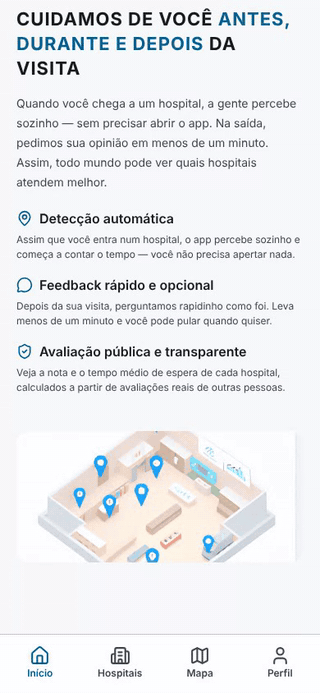
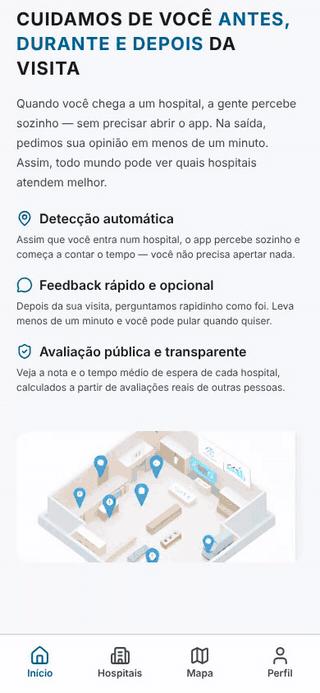
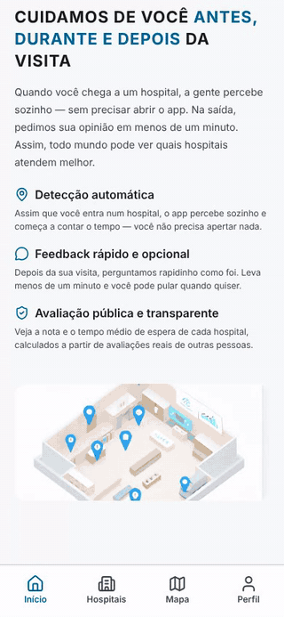
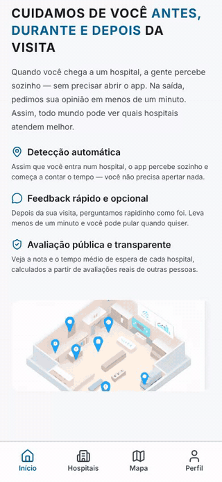
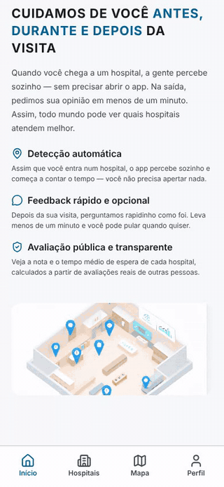
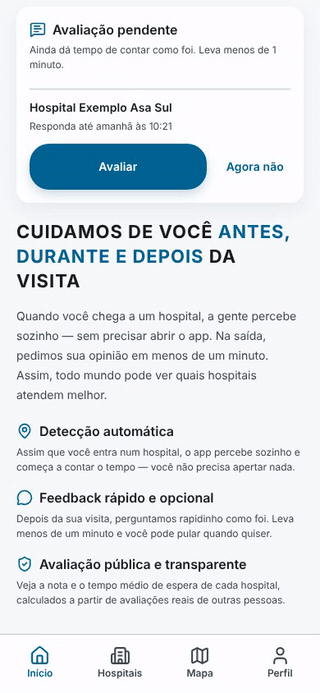
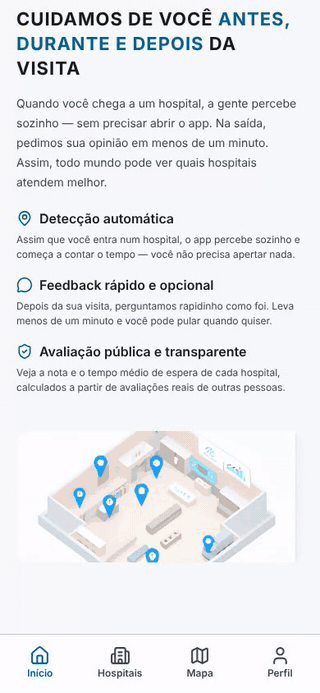

# Radar Saúde

**Quanto tempo se espera em cada hospital do DF, medido por quem esteve lá.**

App gratuito para Android · Distrito Federal · Em homologação, com lançamento público previsto para março de 2027

[Como funciona](#como-funciona) · [Tutorial](#tutorial-tela-a-tela) · [Por que dá para confiar](#por-que-dá-para-confiar) · [Para parceiros e investidores](#para-parceiros-e-investidores) · [Para desenvolvedores](#para-desenvolvedores)

---

## O problema

Quem precisa de um pronto-socorro decide no escuro. Não dá para saber, antes de sair de casa, quanto tempo se espera em cada hospital, e não existe um indicador público e imparcial da experiência de quem foi atendido. Depois da visita, o paciente também não tem um jeito rápido de contar como foi: pesquisa de satisfação longa ninguém responde.

## Como funciona

O Radar Saúde transforma o celular de quem vai ao hospital num termômetro do atendimento, com o mínimo de esforço.

| 1. Você chega | 2. Você sai | 3. Todo mundo vê |
|---|---|---|
| O app percebe pela localização que você entrou numa unidade de saúde e começa a contar o tempo. Você não precisa apertar nada. | Na saída, ele pergunta como foi: poucas perguntas, menos de um minuto, e dá para pular qualquer uma. | A nota e o tempo de cada hospital aparecem para todos, calculados só a partir de visitas reais e só quando há avaliações suficientes. |

Consultar hospitais, ver notas e usar o mapa não exige conta. A conta é opcional e serve só para guardar o seu histórico.

> [!IMPORTANT]
> O Radar Saúde não substitui atendimento de emergência. Em caso de urgência, ligue **192 (SAMU)**.

---

## Tutorial tela a tela

> As gravações abaixo foram feitas com **dados de exemplo**: os hospitais "Exemplo", as notas e os tempos são fictícios e não representam unidades reais.

<table>
<tr>
<td width="290" valign="top"></td>
<td valign="top">

### 1. Início

A primeira tela explica o app em três ideias: a visita é detectada sozinha, a avaliação é rápida e opcional, e o resultado é público.

As quatro abas embaixo levam a tudo: **Início**, **Hospitais**, **Mapa** e **Perfil**.

</td>
</tr>
<tr>
<td valign="top"></td>
<td valign="top">

### 2. Encontre um hospital

Na aba **Hospitais** cada unidade mostra a nota de 1 a 5, quantas avaliações ela tem e o tempo de permanência típico.

- Busque pelo nome ou filtre por público, privado e filantrópico.
- Toque num hospital para ver endereço, telefone, horário e a **avaliação pública**, com o número de atendimentos que a sustentam, o período e a data da última atualização.

</td>
</tr>
<tr>
<td valign="top"></td>
<td valign="top">

### 3. Compare no ranking

O troféu no alto da lista abre o **ranking**. Ordene por **melhor nota** ou por **menor tempo** e combine com o tipo de unidade.

Hospitais com avaliações suficientes para a média fazer sentido vêm primeiro. Os demais aparecem no fim, sem nota.

</td>
</tr>
<tr>
<td valign="top"></td>
<td valign="top">

### 4. Veja o que está perto

Na aba **Mapa** os hospitais aparecem em volta de você. Os filtros de **1, 5, 10 e 25 km** mostram só o que está ao alcance, e tocar num marcador abre o detalhe do hospital.

</td>
</tr>
<tr>
<td valign="top"></td>
<td valign="top">

### 5. A sua visita

**Automática:** com a localização permitida "o tempo todo", o app detecta a entrada e a saída do hospital mesmo fechado, e mostra o temporizador no detalhe do hospital.

**Manual (plano B):** sem GPS ou sem permissão, toque em **Check-in** no card do hospital. O temporizador começa a contar, e **Não estou aqui** encerra a visita quando você sair.

</td>
</tr>
<tr>
<td valign="top"></td>
<td valign="top">

### 6. Conte como foi

Depois da saída, o app avisa e a avaliação fica esperando na tela inicial por até 24 horas.

São etapas curtas: triagem, especialidade e atendimento, receita e tratamento da equipe, e a nota da visita. Todas as perguntas, menos a nota, podem ser puladas. Uma visita vale uma avaliação.

</td>
</tr>
<tr>
<td valign="top"></td>
<td valign="top">

### 7. Conta opcional e seus dados

Quem cria conta acompanha no **Histórico** as visitas e as avaliações feitas, e pode **editar uma avaliação por até 15 dias**.

Em **Perfil** você controla a permissão de localização e as notificações, baixa em PDF tudo o que o app guarda sobre você e pode excluir a conta.

</td>
</tr>
</table>

Quer o passo a passo completo, com cadastro, confirmação de e-mail e recuperação de senha? Veja o [tutorial de primeiros passos](doc/tutorial-usuario/tutorial-primeiros-passos.md).

---

## Por que dá para confiar

- **Tempo medido, não declarado.** A duração da visita vem da localização do celular, da entrada até a saída, e não de alguém digitando quanto esperou.
- **Só conta quem esteve lá.** A avaliação fica ligada a uma visita, cada visita aceita uma avaliação, e só entram na nota pública as visitas registradas dentro da área do hospital.
- **Nada de nota com pouca gente.** Nota e tempo só aparecem com pelo menos 5 avaliações. O tempo usa a mediana, que não se deixa levar por um caso extremo.
- **Método à vista.** Cada hospital mostra quantos atendimentos sustentam o número, o período considerado e quando foi atualizado.
- **Privacidade por padrão.** A avaliação publicada nunca mostra quem avaliou. A localização serve para detectar a visita e pode ser revogada a qualquer momento no Perfil. Política de privacidade, termos de uso e exclusão de conta em [saudemonitor.dev](https://saudemonitor.dev/privacidade/).

---

## Para parceiros e investidores

### A oportunidade

Não existe hoje um dado contínuo e público sobre quanto se espera e como o paciente percebe o atendimento em cada unidade de saúde. O Radar Saúde gera esse dado de baixo para cima: cada visita registrada vira um ponto de medição, e quanto mais gente usa, mais útil o app fica para quem vem depois.

### Modelo

- **Para o cidadão, o app é e continuará gratuito.**
- **Quem paga é o poder público.** Secretarias e conselhos de saúde recebem relatórios agregados por região e por hospital, sempre anônimos e com o mesmo método público do app. A venda começa por conversas e pilotos. Preço e formato de contrato ainda não estão definidos.

### Onde estamos

| | |
|---|---|
| **Produto** | App Android funcional, em homologação (versão candidata `v1.0.0-rc.9`, outubro de 2026). |
| **Cobertura** | 341 estabelecimentos de saúde do DF cadastrados a partir de dados públicos do CNES/DATASUS. |
| **Operação** | API em nuvem (Google Cloud Run), painel administrativo web para a equipe manter o catálogo, site público com política de privacidade, termos e exclusão de conta. |
| **Próximos passos** | Publicação na Play Store, beta fechado com cerca de 50 pessoas por 30 dias e lançamento público no DF em março de 2027. |

O lançamento público só acontece quando o beta atingir pelo menos **3 hospitais com 5 ou mais avaliações**. Antes de ter dado de verdade, o app não mostra número inflado.

### Quer conversar?

Gestores públicos, conselhos de saúde e investidores interessados em um piloto ou em acompanhar o projeto podem falar com [Gabriel Vogado](https://github.com/GabrielVogado), criador do Radar Saúde.

---

## Para desenvolvedores

| Componente | Tecnologia | Pasta |
|---|---|---|
| App mobile | Expo 55, React Native, Mapbox, TanStack Query, Zustand | [`frontend/`](frontend/) |
| API | Java 25, Spring Boot 4, MongoDB | [`backend/`](backend/) |
| Painel administrativo | Angular 21 | [`admin/`](admin/) |
| Site público | Cloudflare Workers | [`site/`](site/) |
| Infraestrutura | Google Cloud Run, GitHub Actions | [`deploy/`](deploy/), [`.github/`](.github/) |

- **Subir o projeto na sua máquina:** [Guia do Ambiente Local](Documentos/02-arquitetura-tecnica/Guia-Ambiente-Local-v1.0.md) (backend com Docker, app com Expo, URLs da API e problemas comuns).
- **Documentação completa:** [índice central](Documentos/00-INDICE.md), com negócio, arquitetura, contratos da API, backlog e histórico de melhorias.
- **Fluxo de trabalho:** branches, ambientes, homologação e deploy no [manual do git-flow](Documentos/10-git-flow/MANUAL.md).
